# Projeto ERP — Multiplikar Automóveis

**Projeto Integrador - Modelagem de Dados**  
**Entrega 1: modelo conceitual (nota 7,5) · Entrega Final: modelo lógico, normalização, implementação SQL e análise de dados**

> A Entrega Final é a versão revisada e ampliada da Primeira Entrega, como orienta o `docs/fontes/MANUAL DA ENTREGA FINAL.pdf`. As Seções 1–18 trazem o levantamento e o modelo conceitual, corrigidos onde a devolutiva apontou problemas; as Seções 19–31 trazem o que foi acrescentado nesta entrega.
>
> **Por onde começar:** [o que a devolutiva apontou e como comprovamos a correção](#secao-19) · [como executar o banco, passo a passo](#secao-25) · [por que um sistema próprio frente ao RevendaMais](#secao-30) · [conferência pelas perguntas do manual](#secao-31)

## Sumário

**Parte 1 — Primeira Entrega (modelo conceitual)**

1. [Identificação da equipe](#secao-1)
2. [Caracterização da empresa](#secao-2)
3. [Justificativa da escolha](#secao-3)
4. [Problemas identificados](#secao-4)
5. [Processos de negócio](#secao-5)
6. [Requisitos funcionais](#secao-6)
7. [Requisitos não funcionais](#secao-7)
8. [Regras de negócio](#secao-8)
9. [Restrições e políticas organizacionais](#secao-9)
10. [Fluxogramas](#secao-10)
11. [Entidades](#secao-11)
12. [Atributos](#secao-12)
13. [Relacionamentos](#secao-13)
14. [Cardinalidades](#secao-14)
15. [Dicionário de dados conceitual](#secao-15)
16. [DER](#secao-16)
17. [Justificativas técnicas](#secao-17)
18. [Conclusão da Primeira Entrega](#secao-18)

**Parte 2 — Entrega Final (modelo lógico, físico e análise de dados)**

19. [Revisão da 1ª entrega e registro de alterações](#secao-19) — cada ponto da devolutiva com a prova da correção; histórico e evolução do projeto (19.1)
20. [Modelo Lógico Relacional](#secao-20)
21. [Normalização (1FN, 2FN, 3FN)](#secao-21)
22. [Dicionário de Dados atualizado](#secao-22)
23. [Requisitos não funcionais revisados](#secao-23)
24. [Escopo financeiro e limitações conhecidas](#secao-24)
25. [Implementação SQL MySQL 8.4](#secao-25) - Workbench, terminal, equivalencias e testes da fase 1
26. [Massa de dados](#secao-26)
27. [Consultas gerenciais](#secao-27)
28. [Consultas de auditoria](#secao-28)
29. [Potencial de BI e IA](#secao-29)
30. [Inovação e valor agregado frente ao RevendaMais](#secao-30) — extensão de propostas, fluxo de caixa e CRM (30.1); por que um sistema próprio (30.2)
31. [Conclusão da Entrega Final](#secao-31) — conferência pelas perguntas do manual (31.1)
32. [Uso de Inteligência Artificial no Projeto](#secao-32) — ferramentas, revisão humana, validação e prompts

<a id="secao-1"></a>

## 1. Identificação da equipe

### 1.1. Integrantes

1. Ana Beatriz Morais Lessa
2. Andrey Azevedo Veloso
3. Aquiles Santana da Silva
4. Brenno Lima do Vale
5. Caique Martins Santos
6. David Alejandro Delgado
7. Erin Jesus Olivera
8. Jocerlan Diniz dos Santos
9. Nicolas Dias da Silva

| Campo | Informação |
|---|---|
| Projeto | Projeto Integrador — Modelagem de Dados |
| Empresa analisada | Multiplikar Automóveis |
| Turma | Engenharia de Software - Manhã/Matutino |
| Disciplina |MODELAGEM DE BANCO DE DADOS |
| Professor(a) | Clóvis Ferraro |
| Instituição | UNICID |
| Data de submissão |2° Semestre - Eng. Software |
| Repositório GitHub | (https://github.com/andreyveloso/modelagem-banco-multiplikar-automoveis) |

Observação: As informações acadêmicas e a estrutura do repositório foram revisadas pelo grupo para a submissão da Primeira Entrega e novamente atualizadas e revisadas para a submissão da Entrega Final.

### 1.2. Contribuições da equipe

| Integrante | Contribuição realizada | Evidência |
|---|---|---|
| Ana Beatriz Morais Lessa | Organização das regras de negócio e políticas organizacionais na 1ª entrega; revisão formal das regras (RN13, RN22, RN08) e registro das alterações para a Entrega Final. | Seções 8, 9 e 19 |
| Andrey Azevedo Veloso | Caracterização da empresa, justificativa, levantamento de problemas, requisitos funcionais e não funcionais, entidades, atributos e relacionamentos na 1ª entrega; revisão dos requisitos não funcionais (RNF06/RNF07), extensão de inovação (propostas, caixa e CRM), testes automatizados, migrações, evidências de execução e conclusão da Entrega Final. | Seções 1, 2, 3, 4, 6, 7, 10.9, 11, 12, 13, 18, 23, 31 e 32; `sql/extensao/`, `sql/testes/`, `sql/migracoes/`, `docs/evidencias/` |
| Aquiles Santana da Silva | Descrição dos processos P01 a P04 e dos fluxogramas correspondentes na 1ª entrega; consultas gerenciais e análise de potencial de BI/IA na Entrega Final. | Seções 5, 10, 27 e 29 |
| Brenno Lima do Vale | Elaboração do DER em notação de Chen e organização do Diário de Bordo na 1ª entrega; conversão para o Modelo Lógico Relacional na Entrega Final. | Seção 16, Seção 1.3, pasta `docs/der` e Seção 20 |
| Caique Martins Santos | Descrição das entidades E01 a E05 no dicionário conceitual na 1ª entrega; atualização do dicionário de dados físico na Entrega Final. | Seções 15 e 22 |
| David Alejandro Delgado | Descrição das entidades E06 a E10 no dicionário conceitual na 1ª entrega; normalização (1FN, 2FN, 3FN) na Entrega Final. | Seções 15 e 21 |
| Erin Jesus Olivera | Justificativas técnicas e consolidação da documentação na 1ª entrega; implementação do script SQL completo (DDL, triggers, views) na Entrega Final. | Seções 17 e 25 |
| Jocerlan Diniz dos Santos | Análise de cardinalidades pelo Método Vá e Volte na 1ª entrega; massa de dados e consultas de auditoria na Entrega Final. | Seções 14, 26 e 28 |
| Nicolas Dias da Silva | Descrição dos processos P05 a P08 e seus fluxogramas na 1ª entrega; escopo financeiro e análise de inovação frente ao RevendaMais na Entrega Final. | Seções 5, 10, 24 e 30 |

As responsabilidades foram divididas entre os integrantes para cobrir todas as etapas solicitadas no manual. Na Primeira Entrega, o grupo alinhou o DER e validou a coerência do modelo; na Entrega Final, converteu o modelo conceitual em modelo lógico e físico, implementou e testou o banco MySQL 8.4 e revisou os pontos da devolutiva do professor antes de consolidar os artefatos no repositório.

### 1.3. Diário de bordo
O registro contínuo das atividades, evolução do modelo e acompanhamento das tarefas do grupo foi documentado aula a aula no modelo oficial de Diário de Bordo disponibilizado pelo professor Clóvis Ferraro.

Os diários de bordo dos integrantes são entregues separadamente, por meio da pasta específica disponibilizada pelo professor, conforme o procedimento estabelecido para a atividade. Por esse motivo, não integram os arquivos deste repositório, e a confirmação da entrega depende dessa pasta externa.


<a id="secao-2"></a>

## 2. Caracterização da empresa

### 2.1. Identificação

| Aspecto | Informação disponível no levantamento |
|---|---|
| Nome | Multiplikar Automóveis. |
| Segmento | Comércio de veículos. |
| Localização | Bairro Vila São Geraldo; cidade e endereço não informados. |
| Atuação | Aproximadamente dois anos na data do briefing. |
| Equipe | Cerca de seis funcionários. |
| Produtos | Veículos novos, seminovos e usados. |
| Controle atual | Sistema RevendaMais (briefing, p. 7); este projeto propõe a modelagem de um banco relacional integrado próprio. |

A Multiplikar Automóveis é uma loja de veículos (novos, seminovos e usados) localizada no bairro Vila São Geraldo. Com cerca de dois anos de mercado e uma equipe enxuta de seis colaboradores, a empresa atua na compra, venda e intermediação de veículos consignados.

### 2.2. Atividades e público

A loja atende clientes interessados em comprar, vender ou trocar veículos. As operações incluem aquisição direta e recebimento de automóveis em consignação. O levantamento também prevê o atendimento a pessoas físicas e jurídicas.

Os processos descritos envolvem colaboradores, especialistas em vistoria técnica, mecânicos parceiros para garantia e instituições financeiras. As atividades incluem atendimento, avaliação, negociação, formalização de contratos, conferência documental, preparação para entrega e assistência de garantia.

### 2.3. Setores e modo de operação

A partir dos processos levantados, organizamos a operação em três frentes práticas:
1. **Comercial / Vendas:** atendimento inicial aos clientes, apresentação dos veículos do estoque, negociação de propostas, fechamento de vendas e prospecção de veículos para troca ou consignação.
2. **Avaliação Técnica e Pátio:** inspeção física e mecânica dos automóveis ofertados, conferência de laudos cautelares, testes de scanner eletrônico e preparação dos veículos para entrega.
3. **Administrativo / Financeiro e Pós-Venda:** conferência de documentos, formalização de contratos, acompanhamento dos repasses de financiamento, registro de despesas e atendimento de ocorrências de garantia.

O fluxo começa com o atendimento e a avaliação do veículo oferecido. Quando há aprovação e interesse comercial, o veículo é registrado como compra própria, consignação ou entrada em troca. Na venda, relacionamos o veículo ao comprador e às condições acordadas. A conclusão e a entrega consideram as condições financeiras, o laudo e a documentação; a entrega marca o início da garantia prevista no modelo.

### 2.4. Fontes e delimitação do estudo

Para realizar este trabalho, nosso grupo analisou o [Briefing Inicial Completo](docs/fontes/briefing-completo.pdf) da empresa e seguiu as diretrizes do [Manual da Primeira Entrega](docs/fontes/manual-primeira-entrega.pdf). O levantamento aponta que a empresa utiliza a ferramenta comercial RevendaMais no balcão (página 7, item 12 do briefing). Entretanto, o sistema atual não centraliza adequadamente as avaliações mecânicas, os laudos cautelares, o recebimento de mais de um carro como entrada em negociações e as ordens de garantia pós-venda. O objetivo do nosso projeto é justamente estruturar um banco de dados relacional integrado para conectar todas essas pontas.

O escopo desta primeira entrega cobre: cadastro de pessoas e colaboradores, atendimento a interessados, avaliação técnica e laudos de vistoria, modalidades de entrada (compra direta, consignação e troca), fechamento de vendas com controle documental e formas de pagamento, ocorrências de garantia e registro de despesas individualizadas por veículo (sem rateio de despesas gerais — ver `docs/escopo-financeiro.md`). Outros módulos, como folha de pagamento e comissões externas, não fazem parte do escopo inicial e serão tratados em etapas posteriores do curso.

Todas as decisões tomadas pelo grupo estão justificadas na Seção 17. Como solicitado nesta fase, focamos na construção do modelo conceitual (diagrama DER e dicionário de dados); as tabelas físicas, tipos SQL e normalização serão feitos nas próximas entregas. *(Entrega Final: realizados — ver Seções 19–31.)*

<a id="secao-3"></a>

## 3. Justificativa da escolha

Escolhemos a Multiplikar Automóveis porque o comércio automotivo de seminovos oferece um cenário muito prático e interessante para a modelagem de banco de dados. Diferente de um comércio tradicional com vendas simples de produtos de prateleira, uma revenda lida com transações complexas: veículos são comprados de particulares, deixados por clientes em consignação ou aceitos como parte do pagamento (troca).

Além disso, a existência de vistorias técnicas com laudos cautelares, aprovação de financiamento bancário e atendimento de garantia na própria loja faz com que o fluxo de informações seja intenso. Atualmente, os controles descentralizados geram retrabalho e risco de informações desencontradas entre o pátio, a oficina e a parte financeira. A modelagem de um banco relacional integrado é fundamental para organizar essas rotinas e dar confiabilidade à gestão da loja.

<a id="secao-4"></a>

## 4. Problemas identificados

O uso de planilhas sem integração pode levar a retrabalho, divergências entre registros e dificuldade para acompanhar veículos e atendimentos ao longo das etapas. Com base no briefing e nos processos descritos, organizamos os problemas e as necessidades correspondentes:

| ID | Problema Operacional Identificado | Consequência no Negócio | Necessidade do Sistema | RF |
|---|---|---|---|---|
| PROB01 | Registros de uma pessoa podem ficar separados quando ela compra, vende ou consigna. | Cadastros repetidos, histórico fragmentado e retrabalho de digitação. | Unificar o cadastro com múltiplos papéis associados à mesma pessoa. | RF01–RF03 |
| PROB02 | Falta de vínculo entre laudo técnico, avaliação e aceitação do veículo. | Dificuldade para consultar o histórico da avaliação e do estado informado do carro. | Vincular a avaliação técnica e o laudo cautelar à entrada do veículo. | RF04–RF06 |
| PROB03 | Coexistência de modalidades distintas de entrada (compra própria, consignação e troca). | Confusão sobre titularidade do bem, prazos e regras específicas de repasse financeiro. | Distinguir as modalidades de entrada e seus respectivos contratos. | RF07–RF08 |
| PROB04 | Acompanhamento manual da disponibilidade de veículos no pátio. | Possibilidade de divergência de status ou de negociações simultâneas para o mesmo automóvel. | Controle centralizado de disponibilidade e bloqueio de vendas conflitantes. | RF09–RF10 |
| PROB05 | Recebimento de múltiplos veículos como parte do pagamento na mesma venda. | Inconsistência na composição do saldo da venda e perda do vínculo individual de cada entrada. | Registrar múltiplos veículos de troca vinculados à mesma transação. | RF11 |
| PROB06 | Descasamento entre aprovação de crédito e efetivo recebimento bancário. | Baixa prematura de valores não compensados e divergências financeiras. | Distinguir aprovação bancária do efetivo repasse à loja. | RF12–RF13 |
| PROB07 | Dificuldade para acompanhar pendências documentais ou de laudo antes da entrega. | Risco de desencontro entre a situação documental e a liberação do veículo. | Validar requisitos documentais e técnicos antes da liberação da entrega. | RF14 |
| PROB08 | Descontrole de prazos de garantia e procedimentos de devolução em vendas desfeitas. | Insegurança no pós-venda, perda do histórico de manutenções e desorganização na devolução de bens. | Controlar ocorrências de garantia e registrar as restituições em cancelamentos. | RF15–RF16 |
| PROB09 | Dificuldade na apuração de despesas por veículo e consolidação de relatórios gerenciais. | Falta de clareza sobre o lucro real de cada automóvel comercializado. | Vincular custos diretamente ao veículo e gerar relatórios gerenciais. | RF17–RF18 |
| PROB10 | Falta de integração entre condições contratuais acordadas e registros operacionais. | Divergência entre valores negociados, taxas discriminadas e contratos formalizados. | Associar os dados contratuais às operações de compra, venda e consignação. | RF08, RF10–RF14 |
| PROB11 | Dependência de planilhas sem integração entre registros. | Retrabalho de consolidação manual, risco de divergências e lentidão nas consultas. | Centralizar as informações em banco de dados relacional integrado. | RF01–RF18 |

<a id="secao-5"></a>

## 5. Processos de negócio

### P01 — Cadastro e atendimento

- **Objetivo:** identificar o interessado e sua necessidade.
- **Participantes:** interessado e funcionário.
- **Gatilho:** contato ou visita à loja.
- **Etapas:** localizar/cadastrar pessoa; registrar atendimento; identificar interesse em compra, venda ou troca; apresentar alternativas; registrar andamento.
- **Decisões/exceções:** pode não haver negociação; cadastro existente é reutilizado para evitar duplicidades (cadastro único em PESSOA).
- **Informações:** pessoa, contato, informação sobre CNH quando pertinente, interesse, data, responsável e situação.
- **Resultado:** atendimento documentado, mesmo sem venda.
- **Escopo descrito:** etapas detalhadas do funil de leads não foram incluídas no modelo.
- **Origem:** Briefing da loja (p. 4–5 e 7).

### P02 — Avaliação e compra própria

- **Objetivo:** decidir a aquisição e registrar o veículo aceito.
- **Participantes:** proprietário, funcionário e especialista.
- **Gatilho:** oferta de veículo à loja.
- **Etapas:** identificar partes e veículo; avaliar condições e laudo quando aplicável; verificar interesse; negociar; formalizar compra; registrar ENTRADA.
- **Decisões/exceções:** reprovação ou falta de interesse encerra a proposta; aprovação técnica não obriga compra.
- **Informações:** características, quilometragem, condições, decisão, responsável, valor e contrato.
- **Resultado:** veículo adquirido/disponibilizado ou proposta encerrada sem estoque.
- **Hipótese:** cadastro preliminar preserva análise mesmo sem aquisição.
- **Origem:** Briefing da loja (p. 2–4) e esclarecimentos operacionais do levantamento.

### P03 — Consignação

- **Objetivo:** registrar veículo de terceiro disponibilizado para comercialização.
- **Participantes:** proprietário, funcionário e especialista.
- **Gatilho:** proposta de consignação.
- **Etapas:** identificar; avaliar; verificar interesse; negociar preço e repasse; formalizar contrato com reconhecimento de firma; registrar ENTRADA.
- **Decisões/exceções:** prazo normalmente indeterminado; prazo excepcional é registrado.
- **Informações:** proprietário, entrada, preço, repasse, contrato, formalização e prazo eventual.
- **Resultado:** veículo disponível, mantendo vínculo com proprietário até a conclusão da venda.
- **Escopo descrito:** procedimento de retirada do veículo sem venda não foi detalhado.
- **Origem:** Briefing da loja (p. 3 e 7).

### P04 — Venda e veículos recebidos em troca

- **Objetivo:** formalizar uma negociação com um veículo principal.
- **Participantes:** comprador, funcionário e especialista.
- **Gatilho:** escolha do automóvel e proposta.
- **Etapas:** conferir disponibilidade; negociar valores; avaliar cada veículo oferecido; selecionar aceitos; registrar venda e contrato; vincular cada entrada recebida.
- **Decisões/exceções:** veículo reprovado ou sem interesse não integra a troca; proposta pode ser reformulada. Veículos oferecidos pertencem ao comprador, sem terceiros.
- **Informações:** comprador, responsável, veículo principal, ajustes, veículos recebidos e valores aceitos.
- **Resultado:** uma venda, um contrato e zero ou várias entradas vinculadas.
- **Origem:** Briefing da loja (p. 4 e 7–8) e esclarecimentos operacionais do levantamento.


### P05 — Informações de pagamento e financiamento

- **Objetivo:** identificar formas utilizadas e cumprimento financeiro da venda.
- **Participantes:** comprador, funcionário e banco quando houver financiamento.
- **Gatilho:** definição das condições comerciais.
- **Etapas:** registrar formas em VENDA; atualizar total recebido e data; registrar único financiamento quando houver; diferenciar aprovação de recebimento pela loja.
- **Decisões/exceções:** aprovado mas não recebido mantém pendência; não se acompanha parcela do cliente.
- **Informações:** conjunto de formas, total monetário recebido, data mais recente, situação financeira, banco, valor e situação do financiamento.
- **Resultado:** posição financeira resumida, associada à venda.
- **Limite:** não há histórico individual de recebimentos nem valores por forma.
- **Origem:** Briefing da loja (p. 4 e 7) e orientações práticas para a modelagem da primeira entrega.

### P06 — Documentação, conclusão e entrega

- **Objetivo:** cumprir condições financeiras, documentais e técnicas e registrar a entrega.
- **Participantes:** comprador, funcionário e responsáveis técnicos.
- **Gatilho:** venda em formalização.
- **Etapas:** conferir pagamento; conferir CNH, laudo, CRLV, ATPV e comprovante de residência; reconhecer firmas aplicáveis; analisar laudo; registrar conclusão; realizar scanner/preparação; registrar entrega.
- **Decisões/exceções:** pendências impedem o marco correspondente. Os critérios de autorização diante de apontamentos técnicos permanecem a validar.
- **Informações:** documentos conferidos, situação documental, reconhecimento, laudo, scanner, conclusão, entrega e garantia.
- **Resultado:** venda concluída e entrega registrada, iniciando a garantia concedida.
- **Observação:** o reconhecimento de firma é exigido apenas nos documentos pertinentes de transferência (como ATPV e contratos de compra/consignação), dispensando-se tal formalidade para documentos comprobatórios simples (como comprovante de residência e CNH).
- **Origem:** Briefing da loja (p. 7) e esclarecimentos operacionais do levantamento.

### P07 — Garantia e devolução

- **Objetivo:** registrar problema, análise e solução, inclusive eventual desfazimento.
- **Participantes:** cliente, funcionário, mecânico e, quando aplicável, consignante ou banco.
- **Gatilho:** comunicação de problema ou acordo de desfazimento.
- **Etapas:** localizar venda; abrir ocorrência; verificar garantia e atendimento externo; diagnosticar; analisar responsabilidade; negociar solução.
- **Decisões/exceções:** quando houver desfazimento, registrar o retorno do veículo vendido e as restituições. Na troca, devolver os veículos recebidos. Na consignação, devolver a parte da loja e avisar o proprietário. Com financiamento, tratar com banco e registrar orientação.
- **Informações:** problema, diagnóstico, mecânico, solução, cancelamento, devoluções e observações.
- **Resultado:** solução registrada ou desfazimento em acompanhamento.
- **Limite:** exceções não descritas são registradas nas observações; não são criados procedimentos bancários ou módulos adicionais.
- **Origem:** Briefing da loja (p. 4 e 7) e esclarecimentos operacionais do levantamento.

### P08 — Despesas e relatórios

- **Objetivo:** organizar custos por veículo e consultas gerenciais do escopo.
- **Participantes:** funcionários e responsáveis administrativos.
- **Gatilho:** ocorrência de despesa ou solicitação de consulta.
- **Etapas:** identificar veículo; registrar despesa; consultar atendimentos, entradas, vendas, posições financeiras e custos.
- **Decisões/exceções:** despesas gerais, rateios e folha salarial ficam fora do modelo.
- **Informações:** data, categoria, descrição e valor por veículo.
- **Resultado:** relatórios sustentados pelos dados modelados.
- **Origem:** Briefing da loja (p. 7).

<a id="secao-6"></a>

## 6. Requisitos funcionais

São capacidades propostas a partir do levantamento para organizar as informações do negócio em um futuro sistema.

| ID | Requisito | Rastreabilidade |
|---|---|---|
| RF01 | O sistema deverá cadastrar pessoas por CPF/CNPJ e contato, reutilizando o cadastro nos diferentes papéis. | P01; PROB01; RN01–RN02 |
| RF02 | O sistema deverá registrar o vínculo funcional, com cargo, admissão e situação. | P01; PROB01; RN03 |
| RF03 | O sistema deverá registrar atendimentos com interessado, funcionário, data, interesse e situação. | P01; PROB01; RN03 |
| RF04 | O sistema deverá cadastrar veículos distinguindo avaliação preliminar de entrada aceita no estoque. | P02; PROB02; RN04–RN05 |
| RF05 | O sistema deverá registrar avaliação, responsável, condições, decisão técnica e interesse comercial. | P02–P04; PROB02; RN06–RN07 |
| RF06 | O sistema deverá registrar laudos por veículo e sua consulta nas avaliações. | P02–P06; PROB02; RN08 |
| RF07 | O sistema deverá registrar cada entrada aceita como compra própria, consignação ou troca. | P02–P04; PROB03; RN09 |
| RF08 | O sistema deverá registrar contraparte, valores, contrato e condições específicas de cada entrada. | P02–P03; PROB03/10; RN10–RN12 |
| RF09 | O sistema deverá apresentar a disponibilidade dos veículos e impedir vendas simultâneas incompatíveis. | P04; PROB04; RN13 |
| RF10 | O sistema deverá registrar venda com comprador, funcionário, veículo principal, valores e contrato. | P04; PROB04/10; RN14–RN15 |
| RF11 | O sistema deverá vincular todos os veículos aceitos como entrada à mesma venda, com avaliações e valores individuais, sem terceiros. | P04; PROB05; RN16–RN18 |
| RF12 | O sistema deverá registrar em VENDA o conjunto de formas de pagamento e, separadamente, total recebido, data mais recente e situação financeira. | P05; PROB06; RN19–RN20 |
| RF13 | O sistema deverá registrar em VENDA o único financiamento e distinguir aprovação do recebimento, sem controlar parcelas do cliente. | P05; PROB06; RN21 |
| RF14 | O sistema deverá registrar documentos conferidos, reconhecimento aplicável, laudo, scanner, conclusão e entrega, verificando as condições de cada marco. | P06; PROB07/10; RN22–RN24 |
| RF15 | O sistema deverá registrar garantia e ocorrências com diagnóstico, mecânico principal, atendimento externo informado e solução. | P07; PROB08; RN25–RN27 |
| RF16 | O sistema deverá registrar cancelamento, retorno do veículo e devoluções, com comunicação ao consignante e observações da tratativa bancária quando aplicáveis. | P07; PROB08; RN28–RN31 |
| RF17 | O sistema deverá registrar despesas com data, categoria, descrição, valor e veículo. | P08; PROB09; RN32 |
| RF18 | O sistema deverá apresentar consultas de leads, disponibilidade, histórico comercial, despesas e posição financeira resumida das vendas. | P08; PROB09; RN33 |

Os requisitos RF09 e RF14 asseguram a integridade operacional das vendas e entregas, enquanto o RF18 concentra as consultas operacionais essenciais ao escopo delimitado nesta primeira etapa.

<a id="secao-7"></a>

## 7. Requisitos não funcionais

Os requisitos não funcionais definem os parâmetros essenciais de segurança, integridade, desempenho e usabilidade que orientarão o projeto lógico e a implementação do sistema:

| ID | Condição proposta | Verificação |
|---|---|---|
| RNF01 | O acesso a dados pessoais e financeiros deverá respeitar perfis autorizados. | Testar operações permitidas e negadas após definição dos perfis. |
| RNF02 | Documentos e informações pessoais deverão ser protegidos contra consulta/exportação não autorizadas. | Verificar restrições sobre CPF/CNPJ, contato, endereço e referências documentais. |
| RNF03 | Alterações de valores, situação financeira e cancelamento deverão ser rastreáveis. | Reconstruir autor, momento e conteúdo alterado; prazo de retenção definido pela política de privacidade da loja. |
| RNF04 | Operações concorrentes não deverão permitir vendas incompatíveis do mesmo veículo. | Testar tentativas simultâneas de conclusão. |
| RNF05 | Vínculos entre veículo, avaliação, entrada e venda deverão permanecer íntegros. | Rejeitar associações contraditórias e preservar histórico. |
| RNF06 | Consultas deverão ter desempenho adequado ao atendimento. | Definir volume, concorrência e tempo aceitável antes de implementar. |
| RNF07 | Dados deverão ser recuperáveis após falha. | Definir perda máxima e prazo de recuperação; testar restauração. |
| RNF08 | A interface deverá distinguir os estados comercial, financeiro, documental e de entrega. | Validar tarefas e navegação por teclado, com rótulos claros. |

Tabelas e controles estritamente técnicos de infraestrutura (como logs detalhados de auditoria e segurança) serão detalhados nas etapas de modelo lógico e físico.

( parte da Ana Beatriz — PARTE 11: 8. Regras de negócio )

( parte da Ana Beatriz — PARTE 12: 9. Restrições e políticas organizacionais )

<a id="secao-10"></a>

## 10. Fluxogramas

Os fluxogramas representam os processos descritos na seção 5. Cada diagrama identifica os requisitos e as regras correspondentes. Os arquivos `.drawio` são editáveis no diagrams.net; os PNGs podem ser visualizados no GitHub ou inseridos em uma impressão.

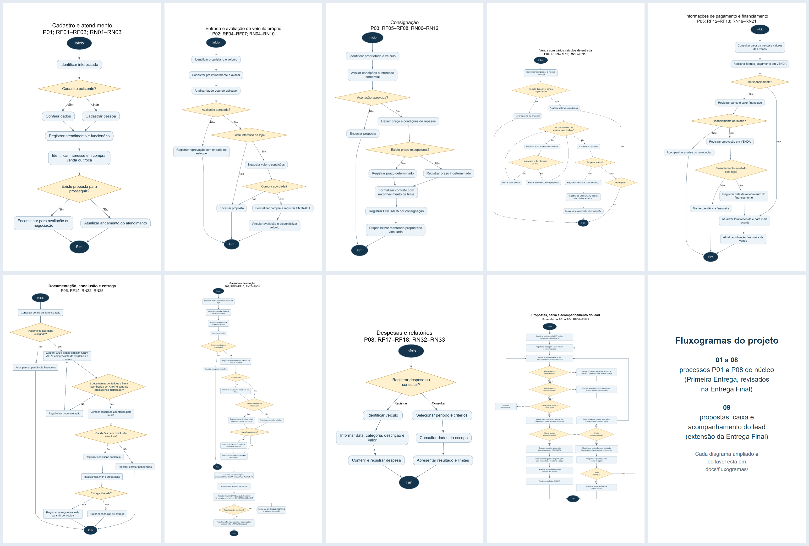

[Abrir visão geral ampliada](docs/fluxogramas/fluxogramas-visao-geral.png)

### 10.1. Cadastro e atendimento

**Referências:** P01; RF01–RF03; RN01–RN03.

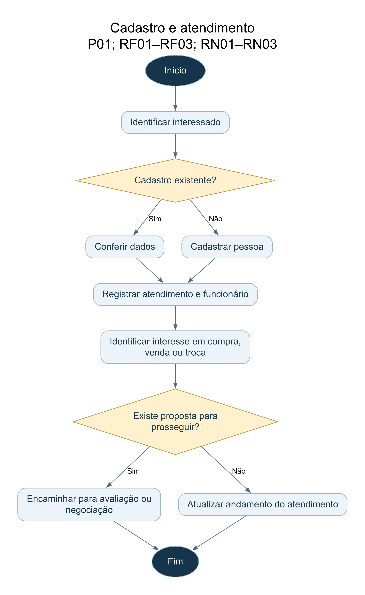

[Abrir PNG](docs/fluxogramas/01-atendimento.png) · [Editar no draw.io](docs/fluxogramas/01-atendimento.drawio)

A decisão de manter um cadastro único para cada pessoa física ou jurídica foi definida para evitar dados repetidos na base.

### 10.2. Entrada e avaliação de veículo próprio

**Referências:** P02; RF04–RF07; RN04–RN10.

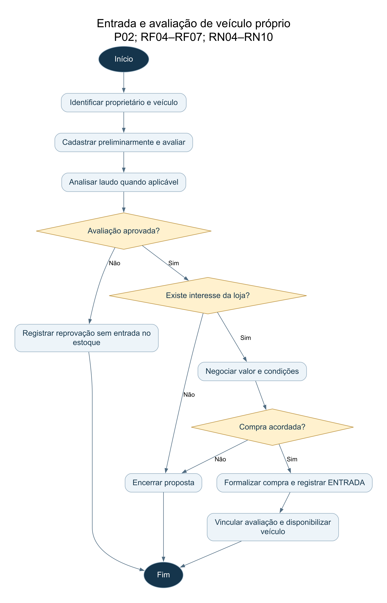

[Abrir PNG](docs/fluxogramas/02-entrada-avaliacao.png) · [Editar no draw.io](docs/fluxogramas/02-entrada-avaliacao.drawio)


### 10.3. Consignação

**Referências:** P03; RF05–RF08; RN06–RN12.

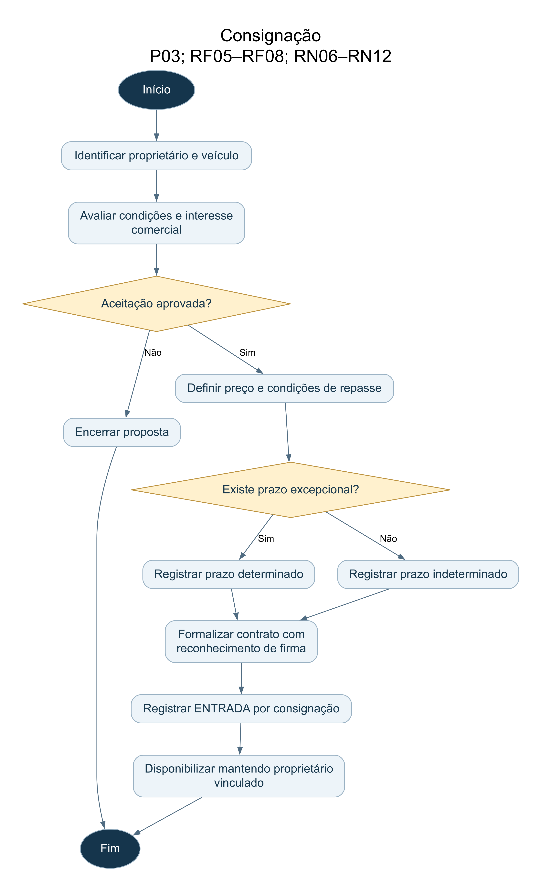

[Abrir PNG](docs/fluxogramas/03-consignacao.png) · [Editar no draw.io](docs/fluxogramas/03-consignacao.drawio)


### 10.4. Venda com vários veículos de entrada

**Referências:** P04; RF09–RF11; RN13–RN18.

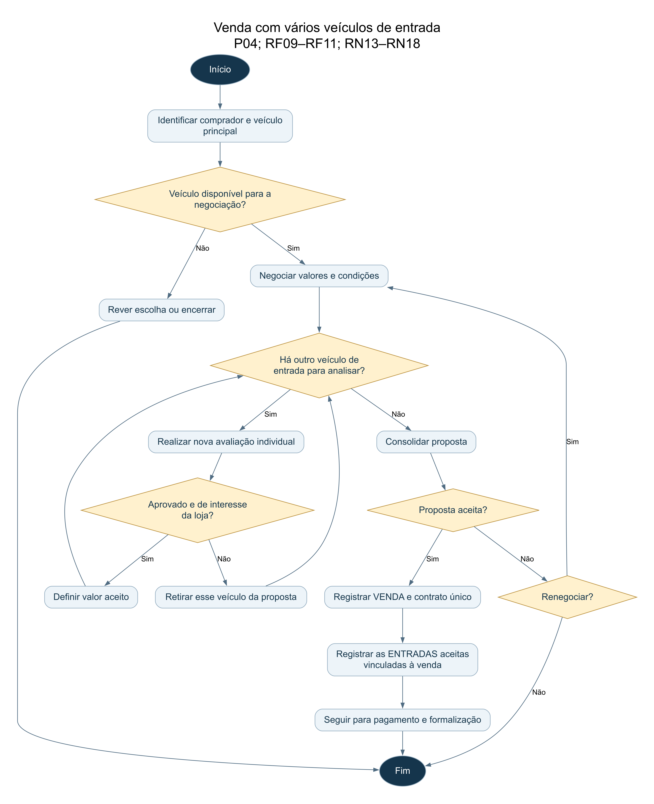

[Abrir PNG](docs/fluxogramas/04-venda-troca.png) · [Editar no draw.io](docs/fluxogramas/04-venda-troca.drawio)

Cada veículo de entrada pertence ao comprador. Sem veículos aceitos, a venda só prossegue se as demais condições forem acordadas.

### 10.5. Informações de pagamento e financiamento

**Referências:** P05; RF12–RF13; RN19–RN21.

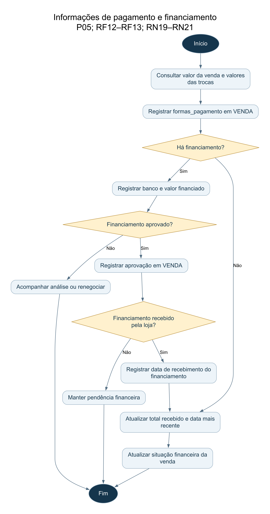

[Abrir PNG](docs/fluxogramas/05-informacoes-pagamento.png) · [Editar no draw.io](docs/fluxogramas/05-informacoes-pagamento.drawio)

formas_pagamento é somente multivalorado, sem componentes. Os valores são totais escalares em VENDA. Não há controle de parcelas nem detalhamento por recebimento.

### 10.6. Documentação, conclusão e entrega

**Referências:** P06; RF14; RN22–RN25.

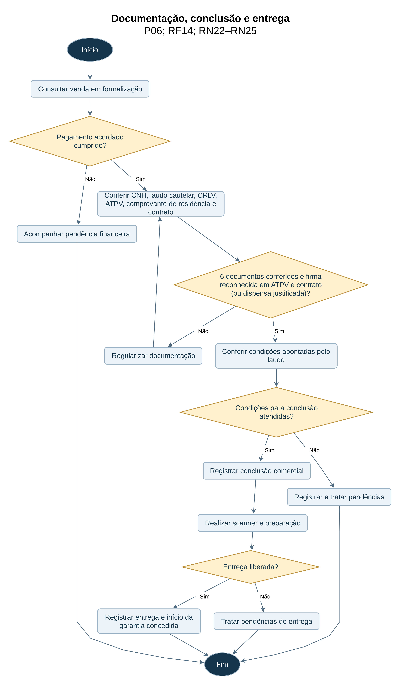

[Abrir PNG](docs/fluxogramas/06-conclusao-entrega.png) · [Editar no draw.io](docs/fluxogramas/06-conclusao-entrega.drawio)

As atividades podem ocorrer em outra ordem; o fluxo representa suas condições. São conferidos CNH, laudo cautelar, CRLV, ATPV, comprovante de residência e contrato. A firma deve ser reconhecida na ATPV e no contrato, salvo dispensa justificada.

### 10.7. Garantia e devolução

**Referências:** P07; RF15–RF16; RN25–RN31.

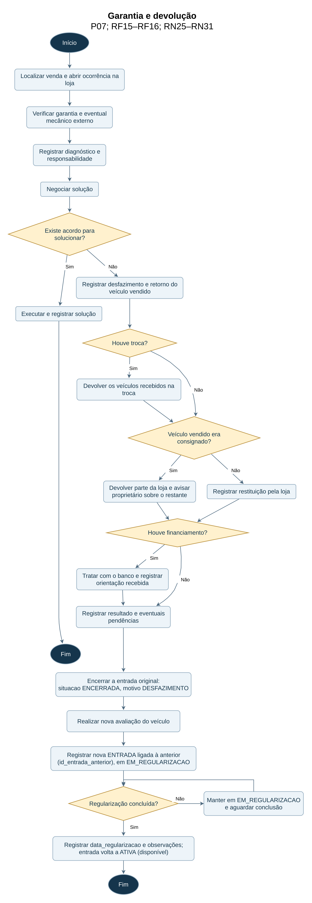

[Abrir PNG](docs/fluxogramas/07-garantia-devolucao.png) · [Editar no draw.io](docs/fluxogramas/07-garantia-devolucao.drawio)

Troca, consignação e financiamento podem coexistir. No desfazimento, a entrada original é encerrada com motivo `DESFAZIMENTO`. Depois de nova avaliação, registra-se uma ENTRADA sucessora ligada por `id_entrada_anterior`, em `EM_REGULARIZACAO`. Ao concluir a regularização, registram-se `data_regularizacao` e observações, e a entrada volta a `ATIVA` (RN13). Pendências são anotadas.

### 10.8. Despesas e relatórios

**Referências:** P08; RF17–RF18; RN32–RN33.

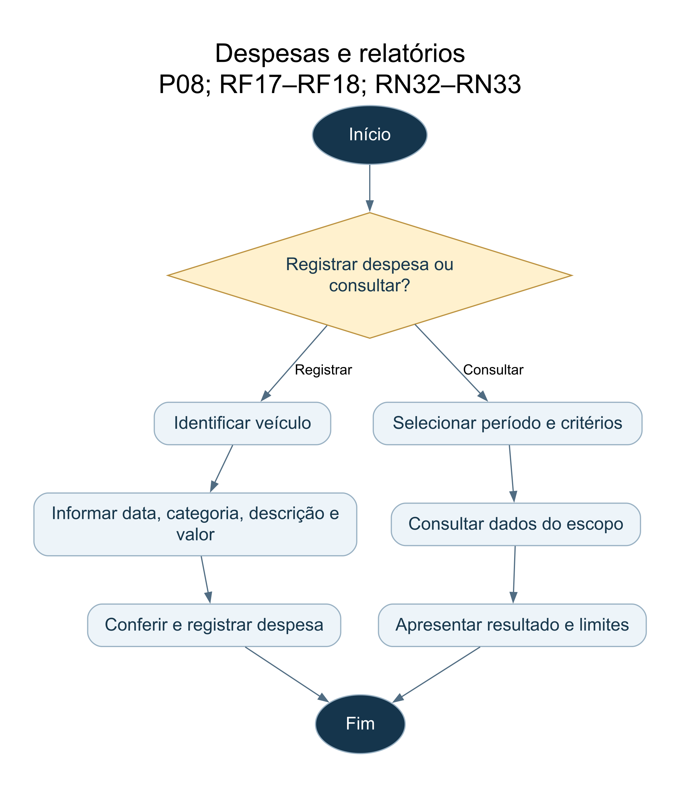

[Abrir PNG](docs/fluxogramas/08-despesas-relatorios.png) · [Editar no draw.io](docs/fluxogramas/08-despesas-relatorios.drawio)

### 10.9. Propostas, caixa e acompanhamento do lead (Entrega Final)

**Referências:** extensão de P01 e P04; RN34–RN44; seção 30.1.

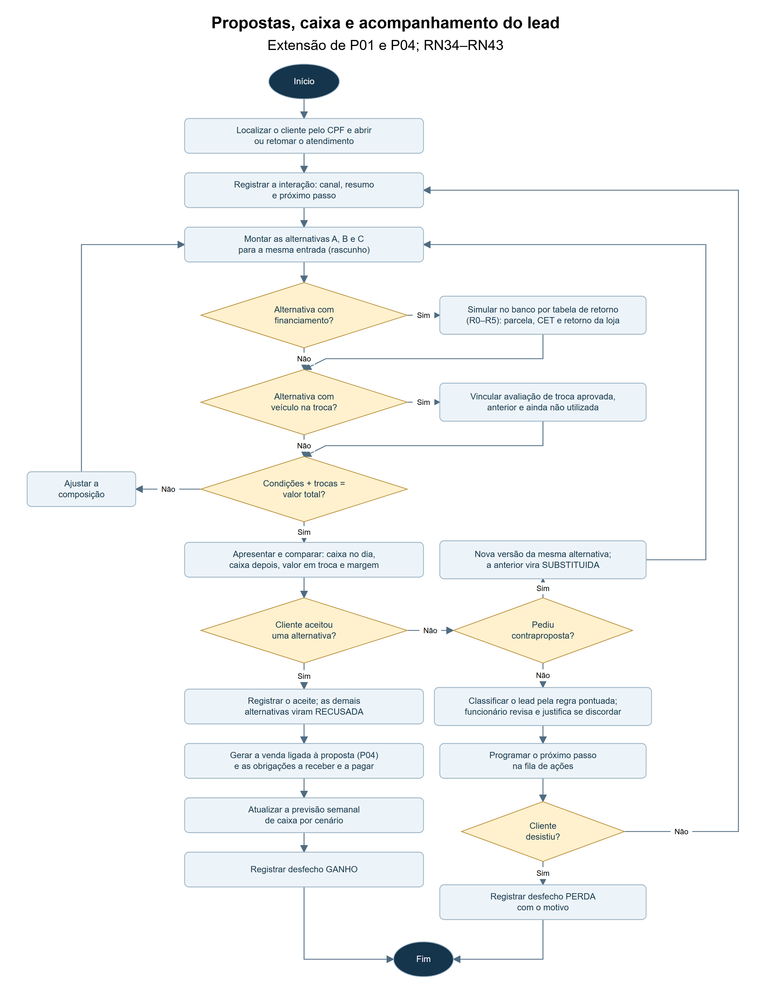

[Abrir PNG](docs/fluxogramas/09-propostas-caixa-crm.png) · [Editar no draw.io](docs/fluxogramas/09-propostas-caixa-crm.drawio)

Acrescentado na Entrega Final para representar a extensão; os oito fluxogramas acima continuam valendo para o núcleo. Antes da venda (P04), o vendedor monta até três alternativas para a mesma entrada. A alternativa com financiamento é simulada por tabela de retorno do banco, e a que tem troca exige avaliação aprovada. A proposta só pode ser apresentada quando condições e trocas somam exatamente o valor total. O aceite de uma alternativa recusa automaticamente as demais, gera a venda e as obrigações a receber e a pagar, e atualiza a previsão de caixa. Sem aceite, o cliente pode pedir contraproposta (nova versão da mesma alternativa) ou o lead é classificado, revisado por um funcionário e segue na fila de ações até ser ganho ou perdido.

<a id="secao-11"></a>

## 11. Entidades

### 11.1. Entidades selecionadas

| ID | Entidade | Propósito |
|---|---|---|
| E01 | PESSOA | Identifica participantes em diferentes papéis, evitando duplicação cadastral. |
| E02 | FUNCIONARIO | Registra dados próprios do vínculo de trabalho; nome e contato permanecem em PESSOA. |
| E03 | Veículo | Identifica o automóvel ao longo de avaliações, entradas, vendas e despesas. |
| E04 | ATENDIMENTO | Preserva contatos e interesses, inclusive quando não resultam em venda. |
| E05 | Avaliação | Registra análise técnica e interesse comercial para fundamentar a aceitação. |
| E06 | LAUDO | Preserva o documento cautelar, sua emissão e seu resultado. |
| E07 | ENTRADA | Registra cada disponibilização aceita: compra própria, consignação ou troca. |
| E08 | VENDA | Representa negociação, contrato, valores, condições de conclusão, entrega e desfazimento. |
| E09 | OCORRENCIA_GARANTIA | Registra cada reclamação, diagnóstico, serviço e solução vinculados à venda. |
| E10 | DESPESA | Registra custos individualizados associados a cada veículo. |


Todas as entidades possuem identificador conceitual. Os atributos são apresentados na seção 12 e descritos no dicionário da seção 15.

### 11.2. Candidatas avaliadas

| Conceito | Decisão e fundamento |
|---|---|
| Cliente, proprietário, fornecedor | Papéis de PESSOA; evita duplicar identificação e contato. |
| Especialista e mecânico | Papéis de PESSOA nos relacionamentos técnicos; FUNCIONARIO se houver vínculo de trabalho. |
| Estoque | Não é entidade: disponibilidade deriva das entradas e vendas. |
| Compra própria e consignação | Modalidades de ENTRADA, com condições próprias. |
| Troca | ENTRADAS relacionadas à mesma VENDA; não cria segunda negociação. |
| Item de venda | Desnecessário para o único veículo principal adotado. |
| Contrato | Atributo composto da operação; não há ciclo independente de versões/aditivos descrito. |
| Financiamento | Atributos simples de VENDA; um por venda confirmado. |
| Instituição financeira | Nome do banco na venda; sem gestão de instituições neste escopo. |
| Garantia concedida | Atributo de VENDA; atendimentos repetíveis em OCORRENCIA_GARANTIA. |
| Preparação | Informação de VENDA, laudo relacionado e scanner registrado. |
| Lead | PESSOA e ATENDIMENTO; não exige novo cadastro quando compra. |
| Pagamento | Não é entidade; formas somente multivaloradas e totais em VENDA. |
| Parcela | Não incluída: não há acompanhamento individual de quitação. |
| Reserva, indicação, comissão | Excluídas desta primeira entrega. |

### 11.3. Estado atual e histórico

Cadastro, avaliações, entradas, vendas e ocorrências preservam o histórico do veículo. A situação atual é derivada das operações vigentes. Não foi criada uma entidade genérica para cada mudança de situação. Auditoria de alterações é uma qualidade exigida por RNF03, a detalhar na implementação.

<a id="secao-12"></a>

## 12. Atributos

### 12.1. Critérios de identificação

Os atributos foram selecionados a partir das informações registradas nos processos P01–P08. Cada um deve descrever a entidade à qual pertence. Os vínculos com pessoas, veículos e operações são representados por relacionamentos, sem antecipar chaves estrangeiras.

### 12.2. Classificação conceitual

| Classificação | Significado | Exemplo no modelo |
|---|---|---|
| Identificador | Distingue uma ocorrência. | identificador de VENDA. |
| Descritivo | Caracteriza um objeto ou participante. | marca de Veículo. |
| Temporal | Registra uma data ou marco. | data_entrega de VENDA. |
| Estado | Indica uma situação operacional. | situação de ATENDIMENTO. |
| Medida/valor | Registra uma quantidade ou valor monetário. | quilometragem de Avaliação; valor de DESPESA. |
| Composto | Reúne componentes conceitualmente identificáveis. | endereço de PESSOA. |
| Multivalorado | Admite vários valores simples para uma ocorrência. | formas_pagamento de VENDA. |
| Derivado | É obtido a partir de outras informações. | valor_total de VENDA. |

### 12.3. Atributos por entidade

| Entidade | Principais grupos de atributos |
|---|---|
| PESSOA | Identificação, documento, contato, endereço e informação sobre CNH. |
| FUNCIONARIO | Cargo, admissão e situação do vínculo. |
| Veículo | Características, placa, chassi e situação atual derivada. |
| ATENDIMENTO | Data, interesse, situação e observações. |
| Avaliação | Finalidade, quilometragem, condições, decisão e interesse comercial. |
| LAUDO | Referência documental, emissão, situação e resultado. |
| ENTRADA | Modalidade, datas, valor acordado, preço anunciado, contrato e condições de consignação. |
| VENDA | Valores, formas de pagamento, financiamento, documentação, conclusão, entrega, garantia e cancelamento. |
| OCORRENCIA_GARANTIA | Problema, diagnóstico, atendimento externo, responsabilidade, serviço e solução. |
| DESPESA | Data, categoria, descrição e valor. |

### 12.4. Tratamento das formas de pagamento

`formas_pagamento` é **somente multivalorado**: pode conter, por exemplo, `{Pix, financiamento}`. Não possui componentes de valor ou data e não é entidade. Total recebido, data mais recente e situação financeira são atributos separados de VENDA.

Essa representação resume a posição financeira e não permite reconstruir recebimentos individuais nem valores por forma. A limitação é assumida para respeitar a orientação acadêmica. A seção 15 descreve todos os atributos, sua obrigatoriedade e suas regras.

<a id="secao-13"></a>

## 13. Relacionamentos

### 13.1. Relacionamentos identificados

Os relacionamentos expressam a participação de pessoas e veículos nas operações da empresa. As multiplicidades são apresentadas separadamente na seção 14.

| ID | Entidade A | Relacionamento | Entidade B |
|---|---|---|---|
| R01 | PESSOA | possui vínculo | FUNCIONARIO |
| R02 | PESSOA | recebe | ATENDIMENTO |
| R03 | FUNCIONARIO | realiza | ATENDIMENTO |
| R04 | Veículo | passa por | Avaliação |
| R05 | PESSOA | responde por | Avaliação |
| R06 | Veículo | possui | LAUDO |
| R07 | Avaliação | consulta | LAUDO |
| R08 | Veículo | possui | ENTRADA |
| R09 | PESSOA | fornece ou consigna | ENTRADA |
| R10 | Avaliação | fundamenta | ENTRADA |
| R11 | PESSOA | compra em | VENDA |
| R12 | FUNCIONARIO | responde por | VENDA |
| R13 | ENTRADA | é comercializada em | VENDA |
| R14 | VENDA | recebe em troca | ENTRADA |
| R15 | LAUDO | documenta | VENDA |
| R16 | VENDA | possui | OCORRENCIA_GARANTIA |
| R17 | PESSOA | mecânico principal | OCORRENCIA_GARANTIA |
| R18 | Veículo | possui | DESPESA |
| R19 | ENTRADA | sucede | ENTRADA |

### 13.2. Integração das operações

- Principal: **VENDA → R13 → ENTRADA → R08 → Veículo**.
- Recebidos: **VENDA → R14 → ENTRADA → R08 → Veículo**.
- Avaliação de aceitação: **ENTRADA → R10 → Avaliação**.
- Cliente da ocorrência: **OCORRENCIA_GARANTIA → VENDA → PESSOA**.
- Veículo da ocorrência: **OCORRENCIA_GARANTIA → VENDA → ENTRADA → Veículo**.

Não se repete um vínculo direto de veículo na venda ou na ocorrência, evitando associações contraditórias.

### 13.3. Análise da relação AVALIAÇÃO — LAUDO e atributos de relacionamento

A relação **R07 (AVALIAÇÃO — consulta — LAUDO)** foi definida como **1:N** (onde AVALIAÇÃO consulta `0,1` LAUDO e LAUDO é consultado por `0,N` AVALIAÇÕES), e não como N:N. Essa definição decorre da realidade operacional: em uma análise técnica, o avaliador examina no máximo o laudo cautelar de referência daquele veículo (ou nenhum, caso ainda esteja pendente de emissão). Por outro lado, um mesmo laudo válido pode subsidiar reavaliações do mesmo veículo ao longo do tempo. Além disso, vigora a restrição semântica de integridade de que o laudo consultado deve pertencer obrigatoriamente ao mesmo veículo avaliado (`AVALIACAO.veiculo == LAUDO.veiculo`).

**PESSOA — Veículo** é mediada por ENTRADA porque data, modalidade, valor e contrato descrevem uma operação concreta, e não uma característica permanente da pessoa ou do automóvel.

Na troca, o valor aceito pertence à ENTRADA daquele veículo na negociação. A identidade do veículo continua a mesma; seu valor pode variar entre operações. ENTRADA tem identidade de evento comercial, não é apenas uma ligação sem conteúdo.

<a id="secao-14"></a>

## 14. Cardinalidades

### 14.1. Convenção e Método Vá e Volte

Para definir as cardinalidades de forma correta e sem inconsistências, aplicamos o **Método Vá e Volte** em todos os 19 relacionamentos do modelo, conforme ensinado na disciplina e solicitado no manual (Etapa 13). Como aprendemos, nunca devemos definir a multiplicidade olhando apenas para um lado da relação. Para cada ligação entre as entidades A e B, analisamos os dois sentidos:
1. **Sentido de Ida (A → B):** Uma ocorrência de A pode se relacionar com quantas ocorrências de B (mínimo e máximo)?
2. **Sentido de Volta (B → A):** Uma ocorrência de B pode se relacionar com quantas ocorrências de A (mínimo e máximo)?

A participação mínima (0) representa associação opcional, enquanto a mínima (1) indica obrigatoriedade. O valor máximo (1 ou N) determina a multiplicidade.

### 14.2. Análise nos dois sentidos

| Relação | Ida (A → B) | Volta (B → A) | Justificativa Técnica (Regra de Negócio) |
|---|---|---|---|
| R01 | (0,1) | (1,1) | Uma pessoa pode não ser funcionária; cada vínculo pertence a uma pessoa. Adotada a hipótese de vínculo funcional único por colaborador (RN01–RN02). |
| R02 | (0,N) | (1,1) | Pessoa pode ter nenhum ou vários contatos; cada atendimento identifica um interessado (RN03). |
| R03 | (0,N) | (1,1) | Funcionário pode ainda não ter atendido; cada atendimento tem um responsável (RN03). |
| R04 | (0,N) | (1,1) | Cadastro pode preceder análise; são possíveis reavaliações. Cada análise examina um veículo (RN05–RN06). |
| R05 | (0,N) | (1,1) | Pessoa pode não ser avaliadora; cada avaliação tem um responsável técnico principal registrado. |
| R06 | (0,N) | (1,1) | Veículo pode ainda não ter laudo ou possuir vários documentos históricos; cada laudo pertence a um veículo (RN08). |
| R07 | (0,1) | (0,N) | Uma avaliação consulta no máximo um laudo cautelar daquele veículo (0 se pendente, 1 se emitido); um laudo pode subsidiar reavaliações do mesmo veículo (RN08). |
| R08 | (0,N) | (1,1) | Cadastro preliminar pode não gerar entrada; novas entradas podem ocorrer em momentos distintos. Cada entrada é de um veículo, unificando compra, consignação e troca. |
| R09 | (0,N) | (1,1) | Pessoa pode fornecer vários veículos; cada entrada tem uma contraparte formalmente identificada (RN10). |
| R10 | (0,1) | (1,1) | Uma análise pode não resultar em entrada; cada entrada aceita utiliza avaliação específica aprovada na vistoria técnica. |
| R11 | (0,N) | (1,1) | Pessoa pode nunca comprar ou comprar várias vezes; cada venda tem um comprador (RN14). |
| R12 | (0,N) | (1,1) | Funcionário pode ter nenhuma ou várias vendas; cada venda tem responsável da loja (RN14). |
| R13 | (0,1) | (1,1) | No ciclo operacional de comercialização, cada entrada aceita pode ser comercializada em no máximo uma venda (0 se disponível, 1 se vendida). Cada venda tem uma entrada principal (RN13–RN14). (Entrega Final: o reuso da mesma entrada após desfazimento foi descartado; R13 é 0,1 também no histórico, e o retorno do veículo gera nova ENTRADA ligada à anterior — RN13.) |
| R14 | (0,N) | (0,1) | Venda pode receber vários veículos. Entrada de compra/consignação não tem venda de origem; para troca, exatamente uma é obrigatória (RN16–RN18). |
| R15 | (0,N) | (0,1) | Laudo pode não ser usado em venda. Venda em formalização pode aguardar laudo; na conclusão o vínculo é obrigatório (RN22). |
| R16 | (0,N) | (1,1) | Venda pode não gerar reclamações ou gerar várias; cada ocorrência pertence à venda original (RN25–RN27). |
| R17 | (0,N) | (0,1) | Pessoa pode não atuar como mecânico; ocorrência pode aguardar designação. Adotado um mecânico responsável principal por atendimento de garantia. |
| R18 | (0,N) | (1,1) | Veículo pode não ter despesas registradas; cada despesa do escopo pertence a um veículo (RN32). |
| R19 | (0,1) | (0,1) | Uma entrada anterior pode ter uma sucessora; cada nova entrada aponta para no máximo uma anterior (RN13). |

### 14.3. Participações condicionais

- R14: uma entrada de troca deve ter exatamente uma venda de origem; compra própria e consignação não possuem esse vínculo.
- R15: uma venda em formalização pode aguardar o laudo; a conclusão exige um laudo do veículo principal.
- R17: uma ocorrência pode ser aberta antes da designação do mecânico principal.
- As multiplicidades históricas de R08 e R13 não autorizam entradas vigentes incompatíveis nem vendas simultâneas do mesmo veículo.

As regras da seção 8 complementam o DER, incluindo avaliação aprovada, interesse comercial, documentos e cumprimento financeiro.


<a id="secao-15"></a>

## 15. Dicionário de dados conceitual

### Convenções

As colunas do dicionário especificam: *Obrigatório* (dado mandatório para a existência da entidade no modelo conceitual); *Condicional* (obrigatório mediante determinada condição ou etapa negocial); *Opcional* (dado complementar cuja ausência não inválida a transação). Identificadores e classificações são conceituais (sem tipos de dados físicos do SQL). Componentes de atributos compostos estão descritos de forma atômica na Seção 15.6.

### E01 — PESSOA

Identifica participantes em diferentes papéis, evitando duplicação cadastral.

| Atributo | Descrição | Classificação | Obrigatoriedade | Regra/observação |
|---|---|---|---|---|
| identificador | Identificação conceitual da pessoa. | Identificador | Obrigatório | RN01–RN02 |
| nome | Nome completo ou denominação da pessoa jurídica. | Descritivo | Obrigatório (contratos e cadastro) | RO02 |
| documento | Espécie (CPF ou CNPJ) e número do documento. | Composto | Obrigatório (identificação) | RN01; não duplicar documento confirmado |
| telefone | Contato telefônico. | Descritivo | Obrigatório (coleta informada) | Dado pessoal |
| email | Endereço eletrônico. | Descritivo | Obrigatório (contratos) | RO02 |
| endereço | Logradouro, número, complemento quando houver, cidade e estado. | Composto | Obrigatório (contratos) | RO02; dados pessoais |
| possui_cnh | Informação declarada sobre possuir CNH. | Descritivo | Condicional (atendimento de compra) | Não é número ou cópia da CNH |

### E02 — FUNCIONARIO

Registra dados próprios do vínculo de trabalho; nome e contato permanecem em PESSOA.

| Atributo | Descrição | Classificação | Obrigatoriedade | Regra/observação |
|---|---|---|---|---|
| identificador | Identificação conceitual do vínculo. | Identificador | Obrigatório | Uma PESSOA por vínculo |
| cargo | Função exercida na empresa. | Descritivo | Obrigatório | Não equivale a perfil de acesso |
| data_admissao | Início do vínculo. | Temporal | Obrigatório | Briefing da loja (campo sugerido) |
| situação | Situação do vínculo funcional. | Estado | Obrigatório | Domínio a validar |

### E03 — Veículo

Identifica o automóvel ao longo de avaliações, entradas, vendas e despesas.

| Atributo | Descrição | Classificação | Obrigatoriedade | Regra/observação |
|---|---|---|---|---|
| identificador | Identificação conceitual do automóvel. | Identificador | Obrigatório | RN04 |
| marca | Marca do veículo. | Descritivo | Obrigatório | Briefing da loja (p. 3) |
| modelo | Modelo comercial. | Descritivo | Obrigatório | Briefing da loja (p. 3) |
| ano_modelo | Um ano de referência, por exemplo 2024. | Descritivo | Obrigatório | Não utilizar intervalo de anos |
| cor | Cor informada. | Descritivo | Obrigatório | Briefing da loja (p. 3) |
| placa | Placa do veículo, quando disponível. | Descritivo | Opcional inicialmente | RN04 |
| chassi | Identificação do chassi, quando disponível. | Descritivo | Opcional inicialmente | RN04; exigência na formalização a validar |
| combustivel | Tipo de combustível. | Descritivo | Obrigatório | Briefing da loja (p. 3) |
| cambio | Tipo de câmbio. | Descritivo | Obrigatório | Manual ou automático, conforme briefing |
| categoria_comercial | Novo, seminovo ou usado. | Descritivo | Obrigatório | Briefing da loja (p. 3) |
| situacao_atual | Posição operacional obtida das entradas e vendas vigentes. | Derivado / estado | Obrigatório | Fora do estoque, disponível, em formalização, vendido ou aguardando regularização; proposta |

### E04 — ATENDIMENTO

Preserva contatos e interesses, inclusive quando não resultam em venda.

| Atributo | Descrição | Classificação | Obrigatoriedade | Regra/observação |
|---|---|---|---|---|
| identificador | Identifica o contato. | Identificador | Obrigatório | RF03 |
| data | Momento do atendimento. | Temporal | Obrigatório | Histórico de leads |
| interesse | Natureza (compra, venda ou troca) e descrição da necessidade. | Composto | Obrigatório | P01 |
| situação | Andamento do atendimento. | Estado | Obrigatório | Etapas a validar |
| observações | Informações complementares pertinentes ao contato. | Descritivo | Opcional | Não substitui os dados da venda |

### E05 — Avaliação

Registra análise técnica e interesse comercial para fundamentar a aceitação.

| Atributo | Descrição | Classificação | Obrigatoriedade | Regra/observação |
|---|---|---|---|---|
| identificador | Identifica a análise. | Identificador | Obrigatório | RF05 |
| data | Momento da avaliação. | Temporal | Obrigatório | Distingue reavaliações |
| finalidade | Compra própria, consignação ou troca. | Descritivo | Obrigatório | RN06, RN17 |
| quilometragem | Quilometragem observada nessa análise. | Medida | Obrigatório | Preserva o momento da observação |
| quantidade_proprietarios | Quantidade de proprietários informada na análise. | Medida | Opcional (se desconhecida) | Convenção de contagem a validar |
| condições | Condições externas, internas, mecânicas, estruturais e documentais. | Composto | Obrigatório ao concluir | Cada dimensão deve ser identificável |
| decisao_tecnica | Aprovada, reprovada ou pendente. | Estado | Obrigatório | RN06 |
| interesse_comercial | Sim, não ou em análise quanto ao interesse da loja. | Estado | Obrigatório | RN07 |
| justificativa | Fundamentação da decisão e dos apontamentos. | Descritivo | Obrigatório ao concluir | PROB02 |

( parte do David — PARTE 21: Entidades E06 a E10 e Detalhamento de Componentes )

<a id="secao-16"></a>

### Entidades E06 a E10 e Detalhamento de Componentes

### E06 — LAUDO

Preserva o documento cautelar, sua emissão e seu resultado.

| Atributo | Descrição | Classificação | Obrigatoriedade | Regra/observação |
|---|---|---|---|---|
| identificador | Identifica o laudo. | Identificador | Obrigatório | RF06 |
| referencia_documental | Referência para localizar o laudo. | Descritivo | Obrigatório | Sem definir formato físico |
| data_emissao | Data de emissão. | Temporal | Condicional (ao emitir) | Briefing da loja (p. 4); nula enquanto o laudo está pendente |
| situação | Situação documental do laudo. | Estado | Obrigatório | Vocabulário a validar |
| resultado | Conclusões e apontamentos cautelares. | Descritivo | Condicional (ao emitir) | Não substitui a decisão da avaliação; nulo enquanto o laudo está pendente |

### E07 — ENTRADA

Registra cada disponibilização aceita: compra própria, consignação ou troca.

| Atributo | Descrição | Classificação | Obrigatoriedade | Regra/observação |
|---|---|---|---|---|
| identificador | Identifica a entrada aceita. | Identificador | Obrigatório | Unificação das modalidades de entrada (compra, consignação e troca) |
| modalidade | Compra própria, consignação ou troca. | Descritivo | Obrigatório | RN09 |
| data_entrada | Data da incorporação operacional aceita. | Temporal | Obrigatório | Não é o cadastro preliminar |
| situação | Ativa, comercializada, em regularização, retirada ou devolvida. | Estado | Obrigatório | Domínio proposto (Entrega Final: acrescido `ENCERRADA` para ciclo encerrado por desfazimento) |
| encerramento | Data e motivo do encerramento, quando houver. | Composto | Condicional | Preserva retirada e desfazimento |
| valor_acordado | Aquisição: preço de compra; consignação: preço combinado; troca: valor aceito. | Valor | Obrigatório | Significado depende da modalidade |
| preco_anunciado | Preço pedido para a comercialização nessa entrada. | Valor | Condicional (ao disponibilizar) | Distinto do valor final da venda |
| contrato_entrada | Referência, data, condições e ajustes da compra própria ou consignação. | Composto | Condicional (compra/consignação) | Ausente na troca, que utiliza o contrato de VENDA |
| reconhecimento_firma | Situação do reconhecimento do contrato de entrada. | Estado | Condicional | Obrigatório na consignação, RN12 |
| prazo_consignacao | Prazo de término, quando excepcionalmente definido. | Temporal | Opcional (para consignação) | Ausência representa prazo indeterminado |
| condicoes_repasse | Critério, valor definido e condições de repasse ao consignante. | Composto | Condicional (para consignação) | Não representa recebimentos individuais |
| data_devolucao | Data da devolução do veículo recebido em troca, se a venda for desfeita. | Temporal | Condicional (no desfazimento) | RN29; situação fica em situação |
| regularizacao | Data e observações da regularização que libera a entrada sucessora depois de um desfazimento. | Composto | Condicional (entrada sucessora) | RN13; exigida para sair de `EM_REGULARIZACAO` (`ck_entrada_regularizacao`) |

### E08 — VENDA

Representa negociação, contrato, valores, condições de conclusão, entrega e desfazimento.

| Atributo | Descrição | Classificação | Obrigatoriedade | Regra/observação |
|---|---|---|---|---|
| identificador | Identifica a negociação. | Identificador | Obrigatório | RN14 |
| data_registro | Registro da proposta aceita. | Temporal | Obrigatório | Data em que a proposta foi formalmente aceita |
| situacao_comercial | Em formalização, concluída, em desfazimento ou cancelada. | Estado | Obrigatório | Domínio proposto |
| data_conclusao | Momento da conclusão comercial. | Temporal | Condicional (quando concluída) | RN22 |
| valor_base | Valor negociado antes dos ajustes. | Valor | Obrigatório | Convenção proposta |
| desconto | Redução comercial aplicada. | Valor | Obrigatório (pode ser zero) | RN15 |
| acrescimo | Acréscimo comercial aplicado. | Valor | Obrigatório (pode ser zero) | RN15 |
| taxas | Total dos encargos da venda, discriminados no contrato. | Valor | Obrigatório (pode ser zero) | RN15 |
| valor_total | Valor base menos desconto, mais acréscimo e taxas. | Derivado / valor | Obrigatório | Não subtrai a troca do preço total |
| contrato_venda | Referência, data e condições do contrato principal. | Composto | Condicional (na formalização) | Discrimina todos os veículos recebidos e seus valores |
| documentos_conferidos | Conjunto dos documentos apresentados e conferidos. | Multivalorado | Condicional (para formalização) | Valores simples: CNH, laudo cautelar, CRLV, ATPV, comprovante de residência e contrato |
| situacao_documental | Situação global da documentação necessária. | Derivado / estado | Obrigatório | Calculada nas views `vw_venda_validacao` e `vw_venda_resumo` |
| reconhecimento_documental | Situação e data do reconhecimento de firma dos documentos aos quais ele se aplica. | Composto | Condicional (antes de concluir) | Não pressupõe firma reconhecida em CNH, laudo ou conta de luz |
| condicao_repasse | Indica comercialização na condição de repasse. | Estado | Obrigatório | Deve constar no contrato quando aplicável |
| formas_pagamento | Conjunto simples das formas utilizadas na venda. | Multivalorado | Condicional (conforme negociação) | Dinheiro, Pix, cartão, financiamento; SEM componentes |
| valor_recebido | Total monetário efetivamente recebido pela loja na venda. | Valor | Obrigatório (inicia em zero) | Inclui financiamento efetivamente recebido; exclui valor dos veículos de troca |
| data_ultimo_recebimento | Data da confirmação monetária mais recente. | Temporal | Condicional (ao receber) | Não é histórico individual de transações |
| situacao_financeira | Pendente, parcial ou integral quanto ao cumprimento econômico acordado. | Derivado / estado | Obrigatório | Calculada nas views `vw_venda_validacao` e `vw_venda_resumo` |
| instituicao_financeira | Banco do único financiamento, quando houver. | Descritivo | Condicional (se houver financiamento) | RN21; sem entidade própria |
| valor_financiado | Valor contratado para cobrir parte da venda. | Valor | Condicional (se houver financiamento) | Não é somado novamente ao valor_recebido |
| situacao_financiamento | Em análise, não aprovado, aprovado a receber ou recebido. | Estado | Condicional (se houver financiamento) | Distingue aprovação e recebimento pela loja |
| data_aprovacao_financiamento | Data da aprovação bancária. | Temporal | Condicional (quando aprovado) | Não conclui a venda sozinha |
| data_recebimento_financiamento | Data do efetivo recebimento do financiamento pela loja. | Temporal | Condicional (quando recebido) | Sem acompanhamento de parcelas do cliente |
| verificacao_scanner | Data, resultado e providências do scanner. | Composto | Condicional (antes da entrega) | RN23 |
| preparacao | Providências executadas para preparar o veículo. | Descritivo | Opcional (conforme necessidade) | Custos individualizados ficam em DESPESA |
| data_entrega | Data da entrega efetiva ao comprador. | Temporal | Condicional (quando entregue) | Início da garantia |
| garantia | Concessão, início, fim e condições informadas ao cliente. | Composto | Obrigatório (concessão) | Dois meses a partir da entrega, quando concedida |
| cancelamento | Data, motivo, retorno do veículo, restituição da loja, comunicação ao consignante e observações da solução. | Composto | Condicional (no desfazimento) | Procedimento simples; banco tratado nas observações, sem módulo adicional |

### E09 — OCORRENCIA_GARANTIA

Registra cada reclamação, diagnóstico, serviço e solução vinculados à venda.

| Atributo | Descrição | Classificação | Obrigatoriedade | Regra/observação |
|---|---|---|---|---|
| identificador | Identifica a ocorrência. | Identificador | Obrigatório | RF15 |
| data_abertura | Data de abertura do atendimento. | Temporal | Obrigatório | P07 |
| problema_relatado | Descrição apresentada pelo cliente. | Descritivo | Obrigatório | Não equivale ao diagnóstico |
| atendimento_externo_informado | Informa ida a mecânico externo: sim, não ou não informado. | Estado | Obrigatório | Política declarada, RN26 |
| diagnostico | Resultado da análise técnica. | Descritivo | Condicional (após análise) | RN27 |
| responsabilidade_apurada | Conclusão sobre responsabilidade da loja, mau uso ou análise inconclusiva. | Estado | Condicional (após análise) | Não antecipar conclusão |
| servico_realizado | Reparo ou providência executada. | Descritivo | Condicional (se houver serviço) | P07 |
| solucao | Desfecho acordado ou encaminhamento ao cancelamento. | Descritivo | Condicional (ao encerrar) | RN28–RN31 |
| situação | Andamento da ocorrência. | Estado | Obrigatório | Vocabulário a validar |
| data_encerramento | Data de encerramento do atendimento. | Temporal | Condicional (ao encerrar) | Histórico de pós-venda |

### E10 — DESPESA

Registra custos individualizados associados a cada veículo.

| Atributo | Descrição | Classificação | Obrigatoriedade | Regra/observação |
|---|---|---|---|---|
| identificador | Identifica a despesa. | Identificador | Obrigatório | RF17 |
| data | Data da ocorrência da despesa. | Temporal | Obrigatório | Não significa data de quitação |
| categoria | Classificação gerencial. | Descritivo | Obrigatório | Garantia, diagnóstico ou preparação (`ck_despesa_categoria`) |
| descrição | Objeto da despesa, como bateria, pneus ou serviço. | Descritivo | Obrigatório | Briefing da loja (p. 7) |
| valor | Valor atribuído ao veículo. | Valor | Obrigatório | RN32 |


### 15.1. Formas de pagamento: somente multivalorado

`formas_pagamento` guarda um conjunto de valores simples. Exemplo de aplicação prática:

```text
formas_pagamento = {Pix, financiamento}
valor_total = R$ 80.000,00
valor_recebido = R$ 80.000,00
valor_financiado = R$ 60.000,00
situacao_financiamento = recebido
```

O exemplo não transforma cada forma em uma estrutura com valor/data. **Não há componentes, identificador por recebimento nem registros financeiros individuais.** O valor financiado já integra o total recebido quando efetivamente repassado à loja; não é somado novamente.

Essa modelagem atende à diretriz do projeto conceitual de manter as formas de pagamento como atributo multivalorado simples, associando à entidade VENDA os atributos de controle financeiro global (valor recebido, data do último recebimento e situação financeira). O controle detalhado de parcelas e conciliação bancária será desenvolvido nas etapas seguintes de modelo lógico e físico.

### 15.2. Valores, trocas e situação financeira

Convenção proposta:

**valor_total = valor_base − desconto + acrescimo + taxas.**

O total aceito em troca é a soma de `ENTRADA.valor_acordado` das entradas recebidas pela venda. Não é armazenado novamente como atributo independente. O valor do veículo é contrapartida econômica, não dinheiro recebido.

Para uma venda não cancelada, a posição financeira é avaliada a partir de:

**valor_total − valores aceitos das trocas efetivamente incorporadas − valor_recebido.**

Essa consistência garante que o saldo de quitação da venda seja verificado com exatidão considerando valores monetários recebidos e valores aceitos dos veículos de troca. No cancelamento, as restituições são registradas separadamente, preservando os valores históricos da negociação.

### 15.3. Documentos

`documentos_conferidos` é outro conjunto simples, cujos valores são CNH, laudo cautelar, CRLV, ATPV, comprovante de residência e contrato. O comprovante contém nome e endereço; uma conta de luz é exemplo informado, não único formato aceito.

O checklist não substitui o LAUDO: este possui resultado, emissão e veículo próprios. Marcar laudo conferido exige vínculo ao laudo do veículo principal. O modelo registra conferência, sem exigir armazenamento de imagens dos documentos ou criar entidades para cada espécie documental.

O reconhecimento de firma é formalidade aplicada especificamente aos documentos cabíveis de transferência e contratos.

### 15.4. Devolução simples

`cancelamento` concentra data, motivo, data de retorno do veículo vendido, valor devolvido pela loja, data de comunicação ao consignante quando houver e observações do resultado. A situação geral é `situacao_comercial`.

Na troca, `ENTRADA.data_devolucao` e `ENTRADA.situacao` identificam a devolução de cada veículo recebido. Na consignação, as observações registram a parte restante atribuída ao proprietário e a respectiva comunicação. No financiamento, registram-se as instruções recebidas da instituição financeira para formalizar a regularização do cancelamento.

### 15.5. Dados pessoais e duplicidades

Para evitar cadastros repetidos de uma mesma pessoa no sistema, os dados de contato e documento ficam centralizados em PESSOA. Da mesma forma, cliente e veículo da ocorrência de garantia derivam diretamente da venda, mantendo os vínculos diretos e organizados no modelo conceitual.

### 15.6. Detalhamento dos Componentes dos Atributos Compostos

Em conformidade com as diretrizes do Manual da Primeira Entrega (Etapa 17) e a notação conceitual clássica, todo atributo classificado como **composto** é formado por um conjunto de sub-atributos componentes simples (atômicos), descritos a seguir:

| Entidade | Atributo Composto | Sub-atributos Componentes | Descrição de Cada Componente |
|---|---|---|---|
| **PESSOA** | `documento` | `tipo_documento`<br>`numero_documento` | Tipo da identificação civil/fiscal (CPF ou CNPJ).<br>Número do registro cadastral oficial. |
| **PESSOA** | `endereco` | `logradouro`<br>`numero`<br>`complemento`<br>`bairro`<br>`cidade`<br>`estado_uf` | Nome da via pública (rua, avenida).<br>Número predial do imóvel.<br>Complemento residencial (apto, bloco), opcional.<br>Bairro de localização.<br>Município do domicílio.<br>Sigla da Unidade Federativa (UF). |
| **ATENDIMENTO** | `interesse` | `tipo_interesse`<br>`descricao_interesse` | Natureza do contato inicial: compra, venda ou troca.<br>Descrição detalhada da necessidade ou modelo desejado. |
| **Avaliação** | `condicoes` | `condicao_externa`<br>`condicao_interna`<br>`condicao_mecanica`<br>`condicao_estrutural`<br>`condicao_documental` | Estado de lataria, pintura e vidros.<br>Estado de estofamento, painel e acabamentos.<br>Condição de motor, câmbio e suspensão.<br>Integridade de chassi, monobloco e colunas.<br>Situação de débitos, multas e restrições legais. |
| **ENTRADA** | `encerramento` | `data_encerramento`<br>`motivo_encerramento` | Data em que a entrada foi finalizada.<br>Causa do término: venda concluída, desfazimento ou retirada. |
| **ENTRADA** | `contrato_entrada` | `numero_contrato`<br>`data_emissao`<br>`termos_ajustes` | Identificador do contrato de compra própria ou consignação.<br>Data de assinatura do instrumento formal.<br>Cláusulas e acordos específicos pactuados. |
| **ENTRADA** | `condicoes_repasse` | `valor_repasse_acordado`<br>`prazo_repasse`<br>`criterio_repasse` | Valor combinado a ser repassado ao proprietário consignante.<br>Prazo estipulado para liquidação após a venda.<br>Condições e formas acordadas para o pagamento. |
| **ENTRADA** | `regularizacao` | `data_regularizacao`<br>`observacoes_regularizacao` | Data em que a regularização do desfazimento foi concluída.<br>Pendências resolvidas e providências registradas antes de liberar o veículo (RN13). |
| **VENDA** | `contrato_venda` | `numero_contrato`<br>`data_emissao`<br>`termos_condicoes` | Identificador do instrumento formal de compra e venda.<br>Data de celebração do negócio jurídico.<br>Condições comerciais, encargos e veículos de troca aceitos. |
| **VENDA** | `reconhecimento_documental` | `documento_alvo`<br>`situacao_reconhecimento`<br>`data_reconhecimento`<br>`justificativa_dispensa` | Documento que exige firma (ex: ATPV / contrato).<br>Estado do reconhecimento em cartório (pendente ou realizado).<br>Data da efetivação do reconhecimento de firma.<br>Motivo registrado quando o reconhecimento de firma é dispensado. |
| **VENDA** | `verificacao_scanner` | `data_scanner`<br>`resultado_scanner`<br>`providencias_scanner` | Data da passagem do scanner automotivo pré-entrega.<br>Resultado da leitura eletrônica (sem falhas ou códigos de erro).<br>Ajustes técnicos executados antes da entrega. |
| **VENDA** | `garantia` | `concessao_garantia`<br>`data_inicio_garantia`<br>`data_fim_garantia`<br>`termos_politica` | Indicador de concessão da garantia contratual.<br>Data inicial da garantia (marco idêntico à data de entrega).<br>Data limite da vigência (dois meses após a entrega).<br>Condições e política declarada de exclusividade de reparo na loja. |
| **VENDA** | `cancelamento` | `data_cancelamento`<br>`motivo_cancelamento`<br>`data_retorno_veiculo`<br>`valor_restituido_loja`<br>`data_aviso_consignante`<br>`orientacao_bancaria`<br>`observacoes_cancelamento` | Data de formalização do desfazimento do negócio.<br>Motivo declarado para o distrato.<br>Data em que o veículo vendido retornou fisicamente à loja.<br>Quantia financeira devolvida pela loja ao comprador.<br>Data da notificação ao consignante (se veículo consignado).<br>Registro da orientação e tratativa com o banco financiador.<br>Observações obrigatórias do cancelamento (pendências e restituições). |

<a id="secao-21"></a>

## 21. Normalização (1FN, 2FN, 3FN)

A normalização é demonstrada com três exemplos reais do projeto (não genéricos), cada um no formato estrutura antes → dependência funcional → problema → correção:
- **1FN:** formas de pagamento da venda (de atributo multivalorado para `forma_pagamento` + `venda_forma_pagamento`);
- **2FN:** conferência documental por venda (de chave composta com dependência parcial para `venda_documento`);
- **3FN:** avaliação, laudo e veículo (eliminação da dependência transitiva via `avaliacao_laudo`, resolvendo também a integridade avaliação-laudo exigida pela devolutiva).

Conteúdo completo, incluindo a verificação de normalização das 14 tabelas: **[`docs/normalizacao.md`](docs/normalizacao.md)**.

---

## 16. DER

O Diagrama Entidade-Relacionamento (DER) consolidado reúne as 10 entidades conceituais, todos os seus atributos e os 19 relacionamentos levantados nas etapas anteriores. Construímos o diagrama na notação clássica de Peter Chen utilizando a ferramenta diagrams.net (Draw.io), garantindo que todos os elementos exigidos pelo professor estejam claramente legíveis.


[Abrir DER em SVG ampliado](docs/der/der.svg) · [Visualizar imagem PNG](docs/der/der.png) · [Arquivo editável no Draw.io](docs/der/der-multiplikar.drawio)

### 16.1. Convenções de Notação Adotadas

- *Entidades:* representadas por retângulos (ex.: PESSOA, Veículo, VENDA).
- *Relacionamentos:* representados por losangos com os nomes dos verbos que descrevem as interações reais (ex.: compra em, passa por).
- *Atributos:* representados por elipses ligadas às suas respectivas entidades.
  - Atributos *identificadores* aparecem com o nome sublinhado (ex.: <u>identificador</u>).
  - Atributos *multivalorados* possuem contorno duplo (como formas_pagamento e documentos_conferidos).
  - Atributos *derivados* possuem traço pontilhado/tracejado (como valor_total e situacao_atual).
  - Atributos *compostos* possuem seus sub-atributos atômicos detalhados no dicionário de dados (Seção 15.6) para manter o diagrama visualmente limpo e legível.
- *Cardinalidades:* cada conexão indica a participação mínima e máxima da entidade no relacionamento (min, max), conforme detalhado na análise Vá e Volte da Seção 14.
- As relações R13 e R14 distinguem com exatidão o carro principal vendido (é comercializada em) dos carros recebidos como entrada em trocas (recebe em troca).
- **Atualização da Entrega Final:** o DER recebeu o relacionamento R19, autorrelacionamento de ENTRADA *sucede* (0,1):(0,1), que liga o ciclo encerrado por desfazimento ao novo ciclo do mesmo veículo (RN13), conforme exigido pela devolutiva para preservar o histórico de comercialização.
- **Extensão (seção 30.1):** o DER acima segue representando o núcleo. As 14 entidades novas da extensão estão em um DER próprio, na mesma notação e com as mesmas convenções, ligadas às entidades do núcleo que referenciam (ATENDIMENTO, FUNCIONARIO, ENTRADA, VENDA, Avaliação e DESPESA) pelos relacionamentos R20 a R41: [DER da extensão em SVG](docs/der/der-extensao.svg) · [PNG](docs/der/der-extensao.png) · [Draw.io](docs/der/der-extensao.drawio).

<a id="secao-17"></a>

## 17. Justificativas técnicas

### 17.1. Pessoa única e vínculo funcional

*Decisão:* PESSOA concentra identificação e contato; FUNCIONARIO registra o vínculo. *Motivo:* um participante pode comprar, vender e consignar, sem cadastros duplicados. Cargo e admissão não descrevem todas as pessoas. *Base:* PROB01; RF01–RF02; RN01–RN02.

### 17.2. Veículo principal, comercialização e múltiplas entradas

*Decisão:* Uma venda comercializa exatamente uma ENTRADA principal (cardinalidade operacional 0,1) e pode receber várias outras como entrada/troca (0,N). *Motivo:* Garante que cada venda transaciona um único veículo do estoque e impede vendas simultâneas do mesmo automóvel. No modelo operacional, uma entrada resulta em no máximo uma venda concluída. Caso uma venda seja desfeita, a entrada anterior é encerrada e um novo ciclo de ENTRADA é aberto (Entrega Final; o reaproveitamento do mesmo registro foi descartado — RN13). *Base:* PROB04; PROB05; RF09; RF11; RN13; RN16–RN18; Briefing da loja (p. 5).

### 17.3. Compra própria, consignação e troca

*Decisão:* modalidades de ENTRADA com atributos condicionais. *Motivo:* compartilham veículo, contraparte, data, avaliação e valor, mas diferem em propriedade e contrato. A consignação não implica compra do bem pela loja. *Base:* PROB03; RN09–RN12.

### 17.4. Avaliação e laudo (Cardinalidade 1:N e integridade do veículo)

*Decisão:* AVALIAÇÃO e LAUDO são entidades distintas associadas pela relação R07 com cardinalidade 1:N (AVALIAÇÃO consulta 0,1 LAUDO; LAUDO é consultado por 0,N AVALIAÇÕES). *Motivo:* Em uma análise técnica, o avaliador examina no máximo o laudo cautelar de referência do veículo em avaliação (ou nenhum, caso ainda esteja pendente). Um mesmo laudo válido pode subsidiar reavaliações do mesmo veículo ao longo do tempo. Para impedir que o laudo de um carro seja associado à avaliação de outro veículo, adota-se a regra de integridade semântica de que ambos devem pertencer ao mesmo automóvel (Avaliação.veículo == LAUDO.veículo). *Base:* PROB02; RF06; RN08; Briefing da loja (p. 4).

### 17.5. Estoque e histórico

*Decisão:* situação atual derivada das operações, sem entidade ESTOQUE. *Motivo:* o controle é por veículo individual, sem depósitos ou posições físicas informadas. Entradas e vendas preservam o histórico; o estado atual não substitui os eventos. *Base:* RF09; RN13.

### 17.6. Pagamento somente multivalorado

*Decisão:* formas_pagamento contém apenas nomes de formas; totais e datas são outros atributos de VENDA. *Motivo:* atende à orientação acadêmica de representar as formas de pagamento como valores simples e multivalorados. *Limite:* não permite reconstruir transações e valores por forma. *Base:* RN19–RN20; orientação acadêmica.

### 17.7. Financiamento sem entidade

*Decisão:* atributos simples em VENDA. *Motivo:* há no máximo um financiamento e o levantamento exige distinguir aprovação e recebimento, sem parcelas individuais. *Base:* RF13; RN21. O valor financiado é parte do total recebido, quando efetivamente pago à loja, não um recebimento adicional.

### 17.8. Documentação, conclusão e entrega

*Decisão:* registrar documentos conferidos, reconhecimento aplicável, laudo, scanner e datas dos marcos. *Motivo:* conclusão e entrega têm condições e efeitos diferentes; a entrega inicia a garantia. *Base:* PROB07; RN22–RN25. Os critérios para apontamentos técnicos e os responsáveis por aprovações podem ser detalhados nas próximas etapas.

### 17.9. Garantia e ocorrências

*Decisão:* concessão/período na venda; cada reclamação em entidade própria. *Motivo:* podem ocorrer vários atendimentos, com análises e soluções diferentes. A regra sobre mecânico externo é registrada como política declarada. *Base:* RF15; RN25–RN27.

### 17.10. Cancelamento simples

*Decisão:* dados resumidos em VENDA e data de devolução em cada ENTRADA de troca. *Motivo:* registra o retorno dos veículos, as restituições e os encaminhamentos informados no levantamento. O banco é tratado por orientação anotada, e o consignante por comunicação registrada. *Base:* RF16; RN28–RN31; delimitação de escopo.

### 17.11. Contrato, atendimento, preparação e despesa

*Contrato:* atributo composto porque não há gestão independente de versões/aditivos descrita. *Atendimento:* entidade porque existe antes e independentemente da venda. *Preparação:* informação da venda e verificação por scanner, sem ordem de serviço detalhada. *Despesa:* entidade porque é repetível e sustenta relatório por veículo. *Base:* P01, P06, P08; PROB09–PROB10.

### 17.12. Cardinalidades, unicidade e integridade

Mínimos zero representam cadastros sem movimentação inicial ou processos em formalização. Vínculos obrigatórios (mínimo 1) asseguram a contraparte, o responsável e a identificação do veículo. A relação R07 (AVALIAÇÃO–LAUDO) foi definida como 1:N com restrição de mesmo veículo. A relação R13 (ENTRADA–VENDA) adota a cardinalidade operacional (0,1) para refletir a unicidade da comercialização ativa, e, após cancelamento, novo ciclo de entrada (Entrega Final). *Base:* Seção 14; Manual da Primeira Entrega, p. 10–12.

### 17.13. Evolução futura

Modelo lógico, normalização, tipos, chaves físicas e SQL foram realizados na Entrega Final (Seções 19–31); segurança técnica e integração permanecem etapas futuras. O detalhamento financeiro permanece limitado ao resumo registrado em VENDA. Reserva, indicação e comissão só devem retornar se o escopo for reaberto pela equipe.

### 17.14. Resumo das Decisões de Modelagem e Premissas do Projeto

Apresentamos a seguir o resumo executivo das principais decisões conceituais adotadas pelo grupo:

| Classificação | Tema / Questão de Modelagem | Decisão Tomada pelo Grupo e Justificativa Técnica | Referência no Briefing |
|---|---|---|---|
| Fato da empresa | Uso do software RevendaMais | A loja utiliza o RevendaMais no dia a dia comercial, mas este projeto desenvolve a modelagem de um banco relacional integrado próprio para suprir oficinas, laudos e trocas múltiplas. | Briefing, p. 7, item 12 |
| Fato da empresa | Documentos exigidos na venda | CNH, laudo cautelar, CRLV, ATPV e comprovante de residência. O reconhecimento de firma é exigido apenas nos documentos de transferência e contrato. Na Entrega Final, o contrato de venda também passou a ser conferido em `venda_documento` (decisão do grupo). | Briefing, p. 7, item 7 |
| Fato da empresa | Troca com múltiplos veículos | Uma venda pode receber mais de um automóvel como parte do pagamento; cada um tem vistoria própria e pertence obrigatoriamente ao comprador. | Briefing, p. 5–7 |
| Fato da empresa | Requisitos para conclusão da venda | A venda só é finalizada com quitação/crédito do financiamento, conferência documental completa e laudo cautelar realizado. *(Entrega Final: o banco exige laudo existente, do mesmo veículo e emitido até a conclusão; o resultado do laudo é registrado, mas não há exigência de "aprovado" — ver `docs/modelo-logico.md`.)* | Briefing, p. 6–7 |
| Fato da empresa | Scanner pré-entrega e garantia | Obrigatória passagem de scanner veicular antes da entrega; a garantia de 2 meses inicia na data efetiva de entrega ao cliente. | Briefing, p. 7, itens 9–10 |
| Fato da empresa | Regras de desfazimento (cancelamento) | Em caso de cancelamento com troca, a loja devolve os veículos recebidos; em consignação, devolve sua parte e aciona o dono; financiamento segue orientação bancária registrada. | Briefing, p. 4, 6 e 7 |
| Decisão de modelagem | Cadastro unificado em PESSOA | Uma única entidade armazena os dados pessoais e de contato de clientes, colaboradores e proprietários, evitando duplicidades. FUNCIONARIO armazena apenas dados do vínculo empregatício. | PROB01, RF01–RF02 |
| Decisão de modelagem | Entidade unificada ENTRADA | Compras próprias, consignações e trocas compartilham a entidade ENTRADA com atributos condicionais específicos, simplificando o controle do pátio. | PROB03, RN09–RN12 |
| Decisão de modelagem | Formas de pagamento multivaloradas | Modeladas estritamente como atributo multivalorado simples em VENDA (sem tabelas de parcelas ou bancos), respeitando as instruções da primeira entrega conceitual. | Briefing, p. 4 e 7; RN19–RN20 |
| Decisão de modelagem | Relação AVALIAÇÃO–LAUDO (R07) em 1:N | Cada avaliação técnica consulta no máximo um laudo daquele veículo (0,1), e um laudo válido pode apoiar reavaliações do mesmo carro (0,N). Ambos devem pertencer ao mesmo veículo. | RN08 e PROB02 |
| Decisão de modelagem | Relação ENTRADA–VENDA (R13) operacional (0,1) | Cada entrada de estoque só pode estar comercializada em no máximo uma venda ativa/concluída, garantindo o bloqueio de vendas simultâneas do mesmo carro. | RN13 e PROB04 |
| Decisão de modelagem | Associação direta de DESPESA a Veículo | Despesas operacionais e de oficina são vinculadas diretamente ao veículo para permitir relatórios de custo e margem real por unidade vendida. | Briefing, p. 7, item 13; RF17 |
| Premissa de trabalho | Vínculo funcional simples | Foi considerado um único vínculo ativo por funcionário, atendendo perfeitamente ao porte enxuto da equipe de seis funcionários. | Simplificação conceitual |
| Premissa de trabalho | Responsáveis técnicos | Cada avaliação e atendimento de garantia possui a indicação de um mecânico ou especialista responsável principal. | Organização de processos |
| Ponto para etapa lógica | Inconformidades no scanner pré-entrega | Definir na fase de projeto lógico se a reprovação no scanner gera manutenção obrigatória ou cancelamento imediato do contrato. | Aprofundamento futuro |
| Ponto para etapa lógica | Prática de troca com troco | Definir regra para casos raros em que os carros de troca somem valor superior ao do veículo adquirido na loja. | Aprofundamento futuro |
| Resolvido na Entrega Final | Transição de veículo devolvido | O veículo devolvido gera nova ENTRADA ligada à anterior (`id_entrada_anterior`), com nova avaliação, iniciando em `EM_REGULARIZACAO` até a regularização (RN13). | Seções 19–31 |
| Ponto para etapa lógica | Categorização contábil de custos | Estruturar na modelagem física o plano de categorias de despesas (oficina, taxas de despachante, preparação e limpeza). | Aprofundamento futuro |

<a id="secao-18"></a>

## 18. Conclusão

### 18.1. Considerações Finais do Grupo

A elaboração desta primeira entrega permitiu ao nosso grupo aplicar na prática os conceitos fundamentais de modelagem de dados ensinados pelo professor Clóvis. Ao analisar os processos reais da Multiplikar Automóveis, compreendemos que modelar um banco de dados não é simplesmente desenhar caixas e losangos, mas entender a fundo como a empresa opera, quais são seus problemas reais e quais regras precisam ser garantidas pelo sistema.

Conseguimos resolver desafios importantes levantados no briefing, tais como: permitir que múltiplos carros sejam dados em troca na mesma venda, unificar o cadastro de pessoas para evitar redundâncias, diferenciar a aprovação do crédito do efetivo recebimento do dinheiro pela loja e estruturar o controle de garantia pós-venda. O modelo conceitual desenvolvido fornece uma base sólida e sem contradições para a evolução do sistema.

### 18.2. Checklist de Validação da Primeira Entrega

Conforme orientado no checklist final do manual (página 21 e 22), verificamos todos os itens antes da publicação:

| Área Avaliada | Itens Verificados e Cumpridos | Onde Conferir |
|---|---|---|
| **Contexto** | Empresa caracterizada, escolha justificada, problemas e necessidades descritos. | Seções 2, 3 e 4 |
| **Processos** | 8 processos mapeados detalhadamente e 8 fluxogramas desenhados com visão geral. | Seções 5 e 10 |
| **Requisitos** | 18 requisitos funcionais (RF01 a RF18) e 8 não funcionais (RNF01 a RNF08) organizados. | Seções 6 e 7 |
| **Regras e Políticas** | 33 regras de negócio (RN01 a RN33) e 13 restrições organizacionais (RO01 a RO13). | Seções 8 e 9 |
| **Dados e Entidades** | 10 entidades definidas, atributos conceituais classificados e dicionário de dados completo. | Seções 11, 12 e 15 |
| **Relacionamentos** | 19 relacionamentos nomeados por verbos e análise de relacionamentos N:N. | Seção 13 |
| **Cardinalidades** | Mínimos e máximos calculados pelo Método Vá e Volte com justificativas. | Seção 14 |
| **Diagrama (DER)** | Diagrama em notação de Chen com todas as entidades, atributos e relações coerentes. | Seção 16 e `docs/der/` |
| **Justificativas** | Decisões de modelagem e abstração fundamentadas técnica e operacionalmente. | Seção 17 |
| **Documentação** | Repositório estruturado, arquivos editáveis `.drawio` e exportações em PNG/SVG. | Raiz e pasta `docs/` |
| **Equipe e Diário** | Identificação dos 9 integrantes, divisão das contribuições e registro do Diário de Bordo. | Seção 1 |

### 18.3. Próximos Passos do Projeto

*(Registro histórico da Primeira Entrega — os passos abaixo foram executados na Entrega Final, Seções 19–31.)*

Para as etapas seguintes da disciplina, utilizaremos este modelo conceitual como ponto de partida para:
1. Transformar as entidades e relacionamentos no **Modelo Lógico Relacional** (tabelas, chaves primárias e chaves estrangeiras);
2. Aplicar as regras de **Normalização** (1FN, 2FN e 3FN) para eliminar possíveis redundâncias e anomalias de atualização;
3. Desenvolver o **Modelo Físico** com scripts SQL de criação de tabelas (DDL), tipos de dados específicos do SGBD e restrições de integridade (`PRIMARY KEY`, `FOREIGN KEY`, `CHECK`);

---

( parte da Ana Beatriz — PARTE 25: 19. Revisão da 1ª entrega e registro de alterações )

<a id="secao-20"></a>

## 20. Modelo Lógico Relacional

O modelo conceitual foi convertido em **14 tabelas físicas** e **3 views do núcleo** no MySQL 8.4, cobrindo as 10 entidades originais mais 4 tabelas adicionais para atributos multivalorados e para resolver a integridade avaliação–laudo (forma_pagamento, venda_forma_pagamento, venda_documento, avaliacao_laudo). Os 19 relacionamentos do DER foram convertidos com cardinalidade física (PK/FK/UNIQUE), com justificativa individual de cada restrição, e o encadeamento de ciclos de comercialização foi representado pela autorreferência entrada.id_entrada_anterior (RN13).

O projeto tem **28 tabelas**, representadas em dois diagramas: o do **núcleo** (14 tabelas, abaixo), derivado do DER da Primeira Entrega, e o da **extensão** (14 tabelas, logo depois), módulo aditivo que não altera o núcleo (Seção 30.1).

**Núcleo — 14 tabelas:**


[Abrir diagrama em SVG ampliado](docs/modelo-logico/modelo-logico.svg) · [Visualizar imagem PNG](docs/modelo-logico/modelo-logico.png) · [Fonte do diagrama do núcleo (Mermaid)](docs/modelo-logico/modelo-logico.mmd)

**Extensão — 14 tabelas** (propostas, simulação de financiamento, obrigações e caixa, CRM e intenção de compra). As tabelas do núcleo que a extensão referencia (`ATENDIMENTO`, `ENTRADA`, `VENDA`, `FUNCIONARIO`, `AVALIACAO`, `DESPESA` e `FORMA_PAGAMENTO`) aparecem no diagrama apenas para mostrar as chaves estrangeiras; elas não são tabelas novas.


[Abrir diagrama em SVG ampliado](docs/modelo-logico/extensao.svg) · [Visualizar imagem PNG](docs/modelo-logico/extensao.png) · [Fonte do diagrama da extensão (Mermaid)](docs/modelo-logico/extensao.mmd)

> **Notação dos tipos no diagrama:** `VARCHAR_N` representa `VARCHAR(N)` e `DECIMAL_P_S` representa `DECIMAL(P,S)` — limitação de sintaxe do Mermaid, não do banco. Colunas geradas aparecem como `GENERATED STORED` ou `GENERATED VIRTUAL`. Os arquivos `.mmd` são a fonte editável e conferida coluna a coluna com o catálogo do MySQL (259 colunas, mesma nulidade e tipo); as imagens são geradas a partir deles. O arquivo `modelo-logico.drawio` traz o mesmo modelo do núcleo para edição no draw.io, com os tipos MySQL escritos por extenso (`VARCHAR(150)`, `DECIMAL(14,2)`) e a mesma nulidade. Os tipos e tamanhos exatos estão em `sql/ddl/schema.sql` e no [dicionário de dados](docs/dicionario-dados.md).

Os 19 relacionamentos do núcleo e os 22 da extensão, com a regra que cada FK representa, estão em **[`docs/modelo-logico.md`](docs/modelo-logico.md)**. O catálogo nominal de restrições, com a expressão de cada `CHECK`, está na seção 3 do [dicionário de dados](docs/dicionario-dados.md). Contagem do catálogo após `sql/ddl/schema.sql` (núcleo): 14 PK, 23 FK, 9 UNIQUE e 56 CHECK; com a extensão, o banco completo tem 46 FK e 114 CHECK.
Script executável: **[`sql/ddl/schema.sql`](sql/ddl/schema.sql)**.

---

( parte do David — PARTE 27: 21. Normalização (1FN, 2FN, 3FN) )

<a id="secao-22"></a>

## 22. Dicionário de Dados atualizado

O dicionário conceitual preliminar (Seção 15) foi substituído por um dicionário físico completo, cobrindo as 28 tabelas e 11 views com tabela, atributo, descrição, tipo, tamanho, PK, FK, NULL, UNIQUE, DEFAULT e regra/restrição associada — conferido contra o catálogo do MySQL após executar os 14 scripts.

Conteúdo completo: **[`docs/dicionario-dados.md`](docs/dicionario-dados.md)**.

---

<a id="secao-23"></a>

## 23. Requisitos não funcionais revisados

A devolutiva apontou que RNF06 e RNF07 (Seção 7) usavam apenas texto subjetivo ("desempenho adequado"). Foram reescritos com critérios mensuráveis dimensionados para a operação real da loja (6 funcionários):
- **RNF06 (desempenho):** até 6 usuários simultâneos (pico de 15 conexões), volumetria projetada de 5 anos, tempos de resposta por classe de operação (≤0,5s médio / ≤1,0s p95 para consultas de balcão; ≤1,0s p95 para escrita/validação RN22; ≤3,0s p95 para relatórios).
- **RNF07 (recuperação):** RPO <= 15 minutos e RTO <= 2 horas, com backup lógico periódico e retenção do log binário do MySQL para recuperação a um ponto no tempo, quando configurados. A reconstrução da base e a suíte de testes foram executadas; o procedimento de backup de produção está proposto em docs/requisitos-nfr.md.
- **RNF03 (rastreabilidade):** parcial — o banco impede apagar ou adulterar o histórico de entradas e vendas; a trilha de alterações com autor e valores anteriores fica proposta.

Os tempos do RNF06 são metas verificáveis, com roteiro de medição por volume sintético e `EXPLAIN ANALYZE`.

Conteúdo completo, incluindo o quadro consolidado RNF01–RNF08 e o dimensionamento detalhado: **[`docs/requisitos-nfr.md`](docs/requisitos-nfr.md)**.

**Segurança do banco e certificados digitais.** Como o banco está protegido (sem porta aberta para a internet, senhas SCRAM-SHA-256, papéis de menor privilégio, escrita só por funções, API com chave), os certificados TLS 1.3 de cada endereço (Google Trust Services e Let's Encrypt) e como conferi-los: **[`docs/seguranca.md`](docs/seguranca.md)**, com a evidência em [`docs/evidencias/verificacao-seguranca.txt`](docs/evidencias/verificacao-seguranca.txt).

---

<a id="secao-24"></a>

## 24. Escopo financeiro e limitações conhecidas

Responde aos três pontos financeiros pendentes da devolutiva: (a) no núcleo, a tabela `despesa` cobre exclusivamente custos individualizados por veículo, com despesas administrativas gerais fora dela e justificativa técnica; a extensão da Entrega Final registra obrigações administrativas a pagar em `obrigacao_financeira` (origem `ADMINISTRATIVA`, sem vínculo com veículo, venda ou entrada), que entram na previsão de caixa mas não na margem por veículo; (b) quatro limitações conhecidas de tratar formas de pagamento como atributo multivalorado, com proposta de evolução (`OBRIGACAO_RECEBER`/`RECEBIMENTO`); (c) as quatro categorias de obrigação financeira ainda não quitada (saldo do comprador, financiamento aprovado a receber, repasse ao consignante, restituições em distrato) e como cada uma é calculada e protegida por constraint.

Conteúdo completo: **[`docs/escopo-financeiro.md`](docs/escopo-financeiro.md)**.

---

<a id="secao-25"></a>

## 25. Implementação SQL (MySQL 8.4)

Os scripts de sql/ usam MySQL 8.4, InnoDB e utf8mb4; o catálogo validado tem 28 tabelas e 11 views. A cadeia completa foi executada localmente em 01/11/2026: 14 arquivos, 435 PASS e código de saída 0; evidências em docs/evidencias/mysql/.

### Como executar no MySQL Workbench ou terminal

Tudo o que é necessário para criar e testar o banco está neste repositório; basta um servidor MySQL 8.4 com um usuário que possa criar bancos. O servidor usa seu `sql_mode` padrão, incluindo `ONLY_FULL_GROUP_BY`, `NO_ZERO_IN_DATE` e `NO_ZERO_DATE`; nenhum script altera `sql_mode`. A consulta gerencial 3 agrupa pelas expressões projetadas e ordena pelos aliases `ano` e `mes` para ser compatível com esse modo. **Atenção:** `sql/ddl/schema.sql` (e, portanto, o arquivo único) apaga e recria o banco `multiplikar`; use um servidor de testes.

**Opção 1 — MySQL Workbench:** abra `sql/executar-tudo-workbench.sql` e execute tudo, conforme a seção [Executar a cadeia MySQL pelo Workbench](#executar-workbench).

**Opção 2 — linha de comando (qualquer sistema):** na raiz do projeto, com o cliente `mysql` no PATH (troque host, porta e usuário pelos seus; `-p` pede a senha):

```sh
mysql --host=127.0.0.1 --port=3306 --user=root -p --default-character-set=utf8mb4 < sql/executar-tudo-workbench.sql
```

O resultado esperado é o comando terminar sem `ERROR` e a saída conter 435 linhas `PASS`. Para contar: acrescente `> saida.txt` ao comando e use `grep -c "PASS " saida.txt` (Linux/macOS/Git Bash) ou `(Select-String "PASS " saida.txt).Count` (PowerShell).

**Opção 3 — arquivo por arquivo no Windows**, na ordem da lista da seção de execução pelo Workbench, cada um em uma conexão nova. Use o redirecionamento `<` do `cmd`: no Windows PowerShell 5.1, enviar o arquivo com `Get-Content | mysql` pode corromper os acentos.

```powershell
$mysql = "C:\caminho\para\mysql-8.4\bin\mysql.exe"   # ajuste para a sua instalação
cmd /c "`"$mysql`" --host=127.0.0.1 --port=3306 --user=root -p --default-character-set=utf8mb4 < sql\ddl\schema.sql"
```

Repita a segunda linha trocando o arquivo. Nas evidências deste repositório, a equipe usou um servidor local de validação em `127.0.0.1:33306` com `root` sem senha; essa configuração serve apenas para testes e não deve ser exposta nem usada em produção. As execuções da equipe foram feitas com um script local (`RODAR-BANCO-MULTIPLIKAR.bat`) que não faz parte do repositório porque depende de caminhos da máquina de quem o criou; ele apenas executa os mesmos 14 arquivos na mesma ordem e registra `VERSION()` e `@@sql_mode`.

`sql/testes/testes-fluxos.sql` executa verificações da demonstração, validade padrão ancorada em `data_referencia()`, caixa, CRM, PMT/CET R0/R4 e tentativas de violar regras, terminando em ROLLBACK. Resultado: **71 PASS**.

### 25.1. Testes de restricoes

`sql/testes/testes-restricoes.sql` executa tentativas negativas de PK, UNIQUE, FK, CHECK, NOT NULL, DELETE referenciado e alteracao, dentro da transação definida pelo script. Resultado MySQL: 61 linhas PASS (inclui a conferência final). Além das 11 violações originais, a revisão de domínios cobre encerramento de ocorrência, booleanos fora de 0/1, UF inexistente ou minúscula, e-mail fora do formato, textos obrigatórios vazios, campos opcionais nulos, endereço parcial, exigência de e-mail e endereço no contrato, laudo pendente e unicidade da entrada vigente por veículo. `TRUNCATE` não dispara gatilhos no MySQL e não é usado como prova de preservacao de histórico.

### 25.2. Testes de fluxos

sql/testes/testes-fluxos.sql executa verificações da demonstração, validade padrão ancorada em data_referencia(), caixa, CRM, PMT/CET R0/R4 e tentativas de violar regras, terminando em ROLLBACK. Resultado: **71 PASS**.

### 25.3. Testes de relacionamentos

sql/testes/testes-relacionamentos.sql verifica metadados de FK, nulidade e unicidade de R01 a R41, incluindo o gatilho R28: **177 PASS** (133 comportamentais e 44 estruturais).

Em R37, o MySQL bloqueia INSERT direto em `classificacao_lead`; `registrar_classificacao_lead` grava a classificação e seus fatores e limpa a marca de sessão mesmo quando o INSERT falha.

### 25.4. Decisões de implementação no MySQL

O modelo executável usa MySQL 8.4, InnoDB e utf8mb4. A cadeia de 14 scripts registra 435 verificações PASS. A matriz por arquivo, regra e relacionamento está em docs/evidencias/mysql/paridade-testes.md.

| Necessidade | Implementação |
|---|---|
| Unicidade condicionada à situação ativa | Coluna gerada armazenada que retorna NULL fora da condição e índice UNIQUE |
| Regras que consultam mais de uma tabela | Triggers e procedures no ponto de transição |
| Rotinas que precisam gravar na tabela que as acionou | Procedure chamada pela aplicação, com validação e transação controlada |
| Preservação de histórico | Triggers bloqueiam exclusões e alterações não permitidas |
| Classificação com fatores explicativos | Procedure registra a classificação e os fatores como uma operação única |
| Alternativas e contrapropostas | Rótulos A/B/C e versões encadeadas por entrada e atendimento |

---

<a id="secao-26"></a>

## 26. Massa de dados

Massa de dados coerente, com datas em ordem cronológica (atendimento → laudo → avaliação → entrada → venda), cobrindo: venda normal, venda com duas trocas, consignação com financiamento recebido, consignação ativa com prazo, cancelamento com devolução da troca e revenda do mesmo veículo (RN13 na prática), revenda com financiamento recusado e quitada por Pix, financiamento aprovado ainda a receber e ocorrências de garantia. 12 pessoas, 9 veículos, 10 entradas, 6 vendas. Inclui **32 testes de regressão negativos**, que comprovam que constraints e triggers rejeitam operações inválidas (RN08, RN06/RN07, RN13, RN22 inclusive na transição para desfazimento, garantia sem concessão, domínios, unicidade, exclusão de histórico), além de verificações positivas dos cenários e de consistência final.

A massa não foi gerada em escala: cada registro existe para um cenário de negócio específico e é conferido pelos testes automáticos do próprio script, seguindo o ciclo do manual: gerar → testar → validar → corrigir.

Script: **[`sql/dados/massa-dados.sql`](sql/dados/massa-dados.sql)**.

---

<a id="secao-27"></a>

## 27. Consultas gerenciais

14 consultas SQL, cada uma com a pergunta de negócio e a decisão que apoia comentadas no próprio script: modelos mais vendidos por período, clientes que mais compram (com CPF, telefone e e-mail mascarados — LGPD), faturamento mensal das vendas concluídas, veículos parados há mais tempo no estoque, consignações com prazo próximo ou vencido, vendas com troca, posição financeira das vendas, margem por veículo conforme a modalidade (na consignação, venda − repasse − despesas; ex.: Honda City = R$ 5.850), atendimentos convertidos em venda por vendedor, ocorrências de garantia por veículo, vendas aptas para conclusão (RN22) e para entrega (scanner), composição do estoque por modalidade, histórico de reavaliações e vendas canceladas com detalhes de restituição.

Script: **[`sql/consultas/gerenciais.sql`](sql/consultas/gerenciais.sql)**.

<a id="secao-28"></a>

## 28. Consultas de auditoria

Dois grupos de consultas, cada uma com o que verifica, por que importa e o resultado esperado na massa:
- **Verificação de conformidade (14):** confirmam que as regras protegidas pelo banco continuam íntegras — entrada vigente única por veículo (RN13), histórico completo de comercialização do HB20 vendido, devolvido e revendido (RN13), condições simultâneas de conclusão (RN22), laudo do mesmo veículo da avaliação (RN08), entre outras. O esperado é zero violações; servem como relatório de conformidade, por exemplo após uma restauração de backup.
- **Qualidade de dados (8):** procuram situações que o banco **não impede**, mas que merecem ação do gestor — consignação com prazo vencido, venda parada em formalização, financiamento aprovado e não recebido, preço anunciado abaixo do custo ou repasse, ocorrência de garantia aberta há muito tempo, possíveis pessoas duplicadas, veículo sem placa nem chassi e troca de venda cancelada não devolvida. Na massa completa, quatro apontam casos reais: venda 6 parada e seu financiamento a receber, ocorrência do Honda City em análise e os 27 veículos anunciados sem placa/chassi (o anúncio não fornece esses identificadores; devem ser conferidos na inspeção física).

Script: **[`sql/auditoria/auditoria.sql`](sql/auditoria/auditoria.sql)**.

---

<a id="secao-29"></a>

## 29. Potencial de BI e IA

Conforme a etapa 21 do manual, não se implementa uma solução completa de BI ou IA: demonstra-se o potencial dos dados estruturados. São dois exemplos de Business Intelligence (giro de estoque, custo por ciclo e margem por veículo; desempenho de vendedores e funil de conversão) e dois de Inteligência Artificial (previsão de preço e tempo de giro na entrada; risco de garantia ou distrato), cada um no formato problema → dados necessários → análise → possível benefício. O documento traz ainda uma matriz de indicadores (KPIs) com fórmula, consulta SQL correspondente e decisão apoiada, e uma análise do que o modelo já sustenta e das lacunas (comissões, impostos, vínculo direto atendimento → venda e recebimentos individuais).

Conteúdo completo: **[`docs/bi-ia.md`](docs/bi-ia.md)**.

<a id="secao-30"></a>

## 30. Inovação e valor agregado frente ao RevendaMais

A empresa já usa o sistema comercial RevendaMais. Este documento demonstra, com especificidade técnica, 8 problemas operacionais que permanecem sem solução no uso atual do RevendaMais e como o banco de dados proposto resolve cada um (ex.: múltiplos veículos de troca na mesma venda, trava simultânea de conclusão RN22, distrato não destrutivo com encadeamento de ciclos, apuração de custo real por veículo), com matriz comparativa final.

Conteúdo completo: **[`docs/inovacao-valor.md`](docs/inovacao-valor.md)**.

### 30.1. Extensão implementada: propostas por CPF, fluxo de caixa e CRM

A seção 29 mostra o potencial dos dados; esta extensão coloca parte dele em funcionamento. Ela parte de uma pergunta que o RevendaMais não responde: **duas propostas com o mesmo preço deixam a loja na mesma situação?** Não. A extensão mostra cada proposta por três ângulos ao mesmo tempo: o que custa ao cliente, quanto rende à loja e quando o dinheiro entra no caixa.

No caso de demonstração, o mesmo cliente (busca por CPF) recebe três alternativas para o Kwid consignado:

| Alternativa | Caixa no dia | Caixa depois | Em troca | Margem da loja |
|---|---|---|---|---|
| A — Pix integral | R$ 55.000 | — | — | R$ 5.000 |
| B — 20% Pix + 80% financiado | R$ 11.000 | R$ 44.000 em D+15 | — | R$ 5.000 |
| C — Pix + Gol na troca | R$ 25.000 | — | R$ 30.000 | R$ 5.000 |

A margem do veículo é igual nas três, mas o caixa não: como o Kwid é consignado, a loja deve R$ 50.000 ao proprietário em dinheiro. Na alternativa C ela recebe só R$ 25.000 em espécie e fica com o Gol em estoque, ou seja, **a venda lucrativa consome caixa**.

A alternativa B ainda depende da tabela de **retorno** escolhida no banco, a comissão que a instituição paga à loja quando libera o financiamento. Na tabela R0 o cliente paga 48 parcelas de R$ 1.402,56 (R$ 67.322,88 no total) e a loja não recebe retorno. Na R4 a parcela sobe para R$ 1.490,50 (R$ 71.544,00 no total) e a loja recebe R$ 1.760,00, elevando sua margem na B para R$ 6.760. O cliente paga R$ 4.221,12 a mais para a loja ganhar R$ 1.760,00, e por isso o comparador mostra sempre o custo para o cliente ao lado do ganho da loja. O briefing não informa as tabelas de retorno da Multiplikar: taxas e percentuais são hipóteses, e o retorno é receita paga pelo banco, distinta da comissão de vendedores excluída pela RO13. A previsão semanal soma as obrigações já contratadas (como os R$ 80.000 que o banco ainda deve na venda 6) e as propostas abertas ponderadas pela temperatura do lead. No cenário "o banco atrasa 15 dias", ela aponta falta de caixa já na semana de 09/02/2026 (saldo de −R$ 50.950), junto com as obrigações que causam a falta.

O CRM registra cada interação e classifica o lead por uma regra pontuada em que cada fator fica gravado com sua evidência. A classificação é só uma sugestão: um funcionário revisa e, se discordar, precisa justificar. Uma fila de próximas ações cruza CRM, caixa e estoque, explica cada sugestão com os números usados e ordena pelo valor em risco.

A extensão segue aditiva: 14 tabelas, 7 views de negócio e uma view auxiliar, totalizando 11 views no schema, sem alterar o núcleo. As hipóteses financeiras e de classificação permanecem identificadas no banco. A cadeia MySQL 8.4.13 registra 435 PASS; a matriz em docs/evidencias/mysql/paridade-testes.md discrimina cada arquivo, regra e relacionamento.

A classificação do lead é calculada por regra pontuada e explicável (REGRA-V1 e REGRA-V2; a V2 soma a capacidade de pagamento declarada pelo cliente). Cada revisão humana grava a temperatura final e a justificativa. A fila de ações usa esses dados para ordenar prioridades; nenhuma classificação substitui a decisão do funcionário.

DER da extensão: **[`docs/der/der-extensao.svg`](docs/der/der-extensao.svg)** (14 entidades novas, R20 a R41). Regras RN34 a RN44, cardinalidades, normalização, LGPD e roteiro de demonstração: **[`docs/extensao-inovacao.md`](docs/extensao-inovacao.md)**.

### 30.2. Por que um sistema próprio, e não só o RevendaMais

A devolutiva pede que mostremos o que o sistema atual não resolve. Além dos oito problemas da seção 30 e da extensão da seção 30.1, há três razões para a loja ter um banco próprio, ainda que conviva com o RevendaMais no início:

| Dimensão | Sistema de terceiros | Banco próprio proposto |
|---|---|---|
| **Regras do negócio** | A loja usa as regras que o fornecedor oferece; travas próprias da loja, como impedir duas entradas ativas do mesmo veículo ou uma venda concluída sem documentos, dependem do que o produto permite | As regras da loja ficam travadas no próprio banco (RN13, RN22, RN08 e as da extensão), com testes que provam cada uma (seção 19) |
| **Custo** | Assinatura recorrente enquanto a loja usar o sistema; relatórios e integrações novas dependem do fornecedor | MySQL Community é distribuído gratuitamente; o custo passa a ser desenvolvimento, servidor e manutenção, e um relatório novo pode ser uma consulta SQL |
| **Segurança e propriedade dos dados** | CPF, renda, contatos e histórico de clientes ficam no servidor do fornecedor; a exportação completa e a continuidade dependem do contrato | Os dados ficam sob controle da loja, que é a controladora pela LGPD: acesso por perfil, histórico que não pode ser apagado, consentimento registrado para dados de renda e backup com RPO de 15 minutos e RTO de 2 horas (RNF07) |

Também há contrapartidas, e as registramos: com um sistema próprio, a loja passa a responder por backup, atualização e segurança do servidor, tarefas que hoje são do fornecedor. Os valores de mensalidade do RevendaMais não constam do briefing; a comparação de custo fica qualitativa até a loja informar quanto paga. Por isso o caminho proposto é gradual: o banco próprio começa pelo que o RevendaMais não cobre (histórico de ciclos, custo real por veículo, propostas comparadas por caixa e CRM explicável) e assume os demais módulos conforme se prova na operação.

---

<a id="secao-31"></a>

## 31. Conclusão da Entrega Final

A Entrega Final transformou o modelo conceitual em banco relacional normalizado, implementado em MySQL 8.4. Os scripts, a massa e os testes formam a cadeia executável do projeto.

Além do que o manual pede, a equipe implementou uma extensão aditiva (seção 30.1) que liga propostas comerciais, fluxo de caixa e CRM. Ela mostra que propostas com a mesma margem podem ter efeitos de caixa opostos e aponta em que semana falta dinheiro em cada cenário, sem alterar o núcleo avaliado e marcando como hipótese tudo o que ainda depende de dados reais da loja.

A equipe conduziu esta etapa de forma colaborativa, evoluindo o modelo conceitual para o modelo lógico e físico, aplicando as regras de normalização, implementando triggers e views em MySQL 8.4 para garantir as restrições de integridade discutidas na devolutiva, e validando o resultado com massa de dados, testes automatizados e consultas gerenciais e de auditoria. Cada decisão de modelagem foi revisada em conjunto pelo grupo antes de ser incorporada ao modelo final.

### 31.1. Conferência pelas perguntas do manual

O manual (seção 29) pede que a equipe percorra este caminho antes de entregar. As respostas e onde cada uma pode ser verificada:

| Pergunta do manual | Resposta | Onde verificar |
|---|---|---|
| **Requisitos:** as necessidades da empresa continuam representadas? | Sim. Os processos P01–P08 e os requisitos da Primeira Entrega seguem válidos; RNF06 e RNF07 ganharam metas mensuráveis | Seções 5–7 e 23 |
| **Regras de negócio:** estão claras e atualizadas? | Sim. RN01–RN33 no núcleo e RN34–RN44 na extensão, cada uma ligada à restrição ou ao trigger que a protege | Seção 8 / `docs/extensao-inovacao.md` §3 |
| **DER:** representa corretamente as regras? | Sim. O DER do núcleo ganhou o R19 para o histórico de ciclos (RN13), e a extensão tem DER próprio, com R20 a R41 | Seção 16 / `docs/der/` |
| **Modelo lógico:** representa corretamente o DER? | Sim. Cada entidade e relacionamento tem conversão justificada | Seção 20 / `docs/modelo-logico.md` |
| **Normalização:** as tabelas estão em 3FN? | Sim, verificadas uma a uma, inclusive as 14 da extensão | Seção 21 / `docs/normalizacao.md` |
| **Dicionário:** representa o modelo implementado? | Sim. Tipos, tamanhos e restrições conferidos contra o SQL | Seção 22 / `docs/dicionario-dados.md` |
| **SQL:** implementa o modelo lógico? | Sim. Executado do zero em MySQL 8.4.13, 14 scripts com código de saída 0 | Seção 25 / docs/evidencias/ |
| **Massa de dados:** permite testar regras e relacionamentos? | 435 verificações PASS, discriminadas por arquivo, regra e relacionamento | Seções 25.1 a 25.4 / docs/evidencias/mysql/ |
| **Consultas:** respondem a perguntas relevantes? | Sim. Cada consulta traz a pergunta do gestor e a decisão que apoia | Seções 27 e 28 |
| **BI/IA:** os dados têm potencial analítico identificado? | Sim. Indicadores com fórmula e consulta, dois exemplos de IA e a classificação de leads que gera dados rotulados | Seção 29 / `docs/bi-ia.md` |
| **GitHub:** outra pessoa consegue compreender e executar? | Sim. Passo a passo de execução, resultados esperados e histórico de commits | Seções 19.1 e 25 |

Para as perguntas da seção 31 do manual ("Por que esta tabela existe?", "Por que esta FK está aqui?", "Que regra esta constraint protege?"), o dicionário de dados e o modelo lógico trazem a justificativa de cada tabela, chave e restrição, e a seção 19 mostra o teste que prova cada correção.


<a id="secao-32"></a>

## 32. Uso de Inteligência Artificial no Projeto

Ferramentas de IA (Claude Code e Codex) auxiliaram na redação de scripts, testes e documentação da Entrega Final. Cada alteração foi executada numa instância MySQL 8.4 isolada, a partir de um banco vazio, e só foi mantida após passar pela cadeia de testes; mudanças de formatação exigiram prova de equivalência (estrutura idêntica do banco e saídas idênticas das consultas). As decisões de negócio foram tomadas pela equipe, que mantém a responsabilidade técnica pelo conteúdo, conforme a Etapa 17 do manual.

Durante o desenvolvimento, a IA foi usada como apoio à organização, revisão e correção do código, com caráter auxiliar; os prompts dessas etapas não estão integralmente disponíveis e não foram reconstruídos. A IA não foi usada para gerar massa de dados em escala: cada registro existe para um cenário de negócio. Os prompts da revisão final, que têm registro verificável, estão reproduzidos em texto integral.

Registro completo, com os prompts utilizados em texto integral: **[`docs/uso-ia.md`](docs/uso-ia.md)**.

---

<a id="executar-workbench"></a>

## Executar a cadeia MySQL pelo Workbench

Conecte o MySQL Workbench a um servidor MySQL 8.4 de testes (no ambiente da equipe, `127.0.0.1:33306`, usuário `root`). O arquivo único apaga e recria o banco `multiplikar`.

**Jeito mais simples (um clique):** `File > Open SQL Script` → [`sql/executar-tudo-workbench.sql`](sql/executar-tudo-workbench.sql) → botão **raio** (*Execute All*, o primeiro da barra do editor, sem nada selecionado). O arquivo recria o banco do zero e roda os 14 scripts na ordem abaixo; pode ser executado quantas vezes quiser. Resultado esperado: nenhum erro na aba *Output* e 435 linhas `PASS` nas grades de resultado. Última execução registrada pela equipe (02/11/2026, versão final do arquivo): "SQL Script execution completed in 01:25. 846 statements executed successfully." ([print](docs/evidencias/mysql/workbench-executar-tudo.png)). O Workbench informa o número de instruções, não o de linhas `PASS`; os 435 PASS do arquivo estão comprovados pela linha de comando em `docs/evidencias/mysql/executar-tudo-safe.stdout.txt`. A relação entre cada print e a versão exata do arquivo (número de linhas e SHA-256) está em [`docs/evidencias/mysql/workbench.md`](docs/evidencias/mysql/workbench.md).

**Script por script:** abra cada arquivo pelo mesmo menu e clique no raio, nesta ordem:

1. `sql/ddl/schema.sql` (apaga e recria o banco; comece sempre por ele)
2. `sql/dados/massa-dados.sql`
3. `sql/consultas/gerenciais.sql`
4. `sql/auditoria/auditoria.sql`
5. `sql/testes/testes-restricoes.sql`
6. `sql/extensao/01-ddl-propostas-caixa.sql`
7. `sql/extensao/02-massa-propostas-caixa.sql`
8. `sql/extensao/03-ddl-crm.sql`
9. `sql/extensao/04-massa-crm.sql`
10. `sql/extensao/05-consultas-demo.sql`
11. `sql/extensao/06-estoque-loja.sql`
12. `sql/extensao/07-intencao-regra-v2.sql`
13. `sql/testes/testes-fluxos.sql` — verificações da demonstração, validade padrão ancorada em `data_referencia()`, caixa, CRM, PMT/CET R0/R4 e tentativas de violar regras, terminando em ROLLBACK: **71 PASS**.
14. `sql/testes/testes-relacionamentos.sql` — metadados de FK, nulidade e unicidade de R01 a R41, incluindo o gatilho R28: **177 PASS** (133 comportamentais e 44 estruturais).

Cuidados:
- Os scripts de carga usam ids fixos. Rodar um deles de novo sem voltar ao `schema.sql` gera `Duplicate entry` (erro 1062); não é defeito, é a carga repetida.
- O Workbench liga o modo *Safe Updates* por padrão. `massa-dados.sql`, `testes-fluxos.sql` e `testes-relacionamentos.sql` desligam esse modo só durante a execução (fazem `UPDATE`/`DELETE` de teste por colunas que não são chave) e o restauram no fim. Detalhes em [`docs/evidencias/mysql/workbench.md`](docs/evidencias/mysql/workbench.md).
- Use o raio *Execute All* sem seleção. `Ctrl+Enter` executa só o trecho selecionado ou a instrução sob o cursor.

A mesma cadeia pela linha de comando está descrita na [seção 25](#secao-25), apenas com arquivos deste repositório.
