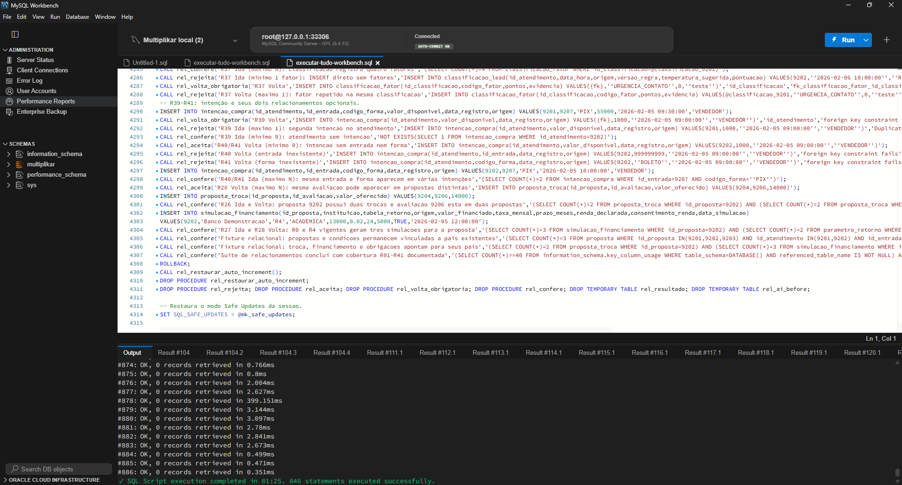

# Execução no MySQL Workbench

Data: 2026-11-01
Conexão: Multiplikar local (root@127.0.0.1:33306)
Workbench: 26.10.0
Servidor: MySQL Community Server 8.4.13
Modo SQL: ONLY_FULL_GROUP_BY,STRICT_TRANS_TABLES,NO_ZERO_IN_DATE,NO_ZERO_DATE,ERROR_FOR_DIVISION_BY_ZERO,NO_ENGINE_SUBSTITUTION

## Método confirmado

O teste mínimo do delimitador foi salvo em arquivo, aberto por File > Open SQL Script e executado sem seleção pelo primeiro raio (Execute All). Resultado observado: 4 statements executed successfully, com Result #5 e Result #5.2; o procedimento temporário foi removido pelo arquivo.

Antes da sequência, RODAR-BANCO-MULTIPLIKAR.bat recriou o banco. Cada script abaixo foi aberto por File > Open SQL Script e executado inteiro pelo primeiro raio, sem seleção. Não foram observados erros.

| # | Arquivo | Resultado observado | Erros |
|---|---|---|---:|
| 01 | sql/ddl/schema.sql | 51 instruções executadas | 0 |
| 02 | sql/dados/massa-dados.sql | PASS: 6 vendas, 10 entradas e 2 ocorrências | 0 |
| 03 | sql/consultas/gerenciais.sql | Consultas executadas; grids exibidos | 0 |
| 04 | sql/auditoria/auditoria.sql | Consultas executadas; grids exibidos | 0 |
| 05 | sql/testes/testes-restricoes.sql | 11 rejeições esperadas e transação desfeita | 0 |
| 06 | sql/extensao/01-ddl-propostas-caixa.sql | 41 instruções executadas | 0 |
| 07 | sql/extensao/02-massa-propostas-caixa.sql | PASS: alternativas A/B/C e comparação R0/R4 | 0 |
| 08 | sql/extensao/03-ddl-crm.sql | 21 instruções executadas | 0 |
| 09 | sql/extensao/04-massa-crm.sql | PASS: classificações e referência 2026-02-10 | 0 |
| 10 | sql/extensao/05-consultas-demo.sql | PASS: previsão semanal e caixa realizado | 0 |
| 11 | sql/extensao/06-estoque-loja.sql | PASS: 27 veículos anunciados disponíveis | 0 |
| 12 | sql/extensao/07-intencao-regra-v2.sql | PASS RN44: três intenções registradas | 0 |
| 13 | sql/testes/testes-fluxos.sql | PASS: fluxo demonstrativo A/B/C | 0 |
| 14 | sql/testes/testes-relacionamentos.sql | PASS R01 visível; script terminou sem erro | 0 |

## Restauração final

Depois da execução pelo Workbench, o .bat foi executado novamente. Resultado observado: 14 arquivos, 382 PASS, exit code 0. A versão e o sql_mode constam em 00-server-info.txt.

As telas foram observadas durante a execução, mas não foi possível salvar capturas individuais PNG nesta rodada.

## Execuções no Workbench pela equipe

Cada execução abaixo foi feita com `sql/executar-tudo-workbench.sql` aberto em *File > Open SQL Script* e o raio *Execute All*, conexão local MySQL 8.4.13 (`root@127.0.0.1:33306`). O Workbench informa o número de instruções executadas, não o de linhas `PASS` (que ficam nas grades de resultado); a contagem de `PASS` de cada versão foi feita pela linha de comando.

| Data/hora do print | Mensagem do Workbench | Versão do arquivo executada | Evidência da versão |
|---|---|---|---|
| 01/11/2026 | 766 instruções, sem erros | antes da revisão de domínios | registro histórico |
| 01/11/2026 | "58s. 833 statements executed successfully." | após a revisão de domínios, antes das correções da auditoria | 431 PASS na linha de comando |
| 02/11/2026 00:18 | "01:02. 846 statements executed successfully." | versão de 01/11/2026 23:33 — 4.301 linhas, SHA-256 `20e84497b787cdcb…` | o arquivo não mudou entre 23:33 e o print; o editor termina na linha 4.302 (linha vazia final) e 846 = 833 + 13 instruções do teste P9; 435 PASS na linha de comando |
| **02/11/2026 00:54** | **"01:25. 846 statements executed successfully."** | **versão final — 4.314 linhas, SHA-256 `ddff9c45bd37dd72…`** | **o arquivo foi modificado pela última vez às 00:24 e o hash foi conferido depois do print; o editor termina na linha 4.315 (linha vazia final); 846 instruções; 435 PASS na linha de comando** |

Depois do print de 02/11 00:18, uma única alteração mudou o arquivo: em `sql/auditoria/auditoria.sql`, três textos de alerta foram quebrados com `CONCAT` (texto idêntico, conferido em comparação binária) e o comentário da auditoria Q7 foi corrigido. A saída das consultas de auditoria ficou idêntica byte a byte e o número de instruções não mudou. Versão atual do arquivo:

| Linhas | Instruções | SHA-256 | Resultado pela linha de comando |
|---|---|---|---|
| 4.314 (o editor do Workbench mostra até a linha 4.315) | 846 | `ddff9c45bd37dd72bffb02884809a3f935d15a335f1c7333e312e248b04b2fba` | 435 PASS, sem erros, com `sql_safe_updates=1`; 870 PASS executando duas vezes na mesma conexão |

Para conferir a versão de um novo print: o editor deve terminar na linha 4.315 e a mensagem deve informar 846 instruções; para conferir o arquivo, `sha256sum sql/executar-tudo-workbench.sql` (ou `Get-FileHash` no PowerShell) deve devolver o hash acima.

Print mais recente (02/11/2026 00:54, versão final de 4.314 linhas — corresponde ao SHA-256 da tabela acima):

## Revisão de domínios (01/11/2026)

As seções "Método confirmado" e "Restauração final" são anteriores à revisão de domínios. Depois dela, `testes-restricoes.sql` passou de 12 para 61 linhas PASS e a cadeia de 382 para 431. A cadeia nova foi validada pela linha de comando numa instância isolada (porta 33307): 14 arquivos, 431 PASS, exit code 0, e o consolidado com `sql_safe_updates=1` sem erros. Depois da correção abaixo, a execução pelo Workbench foi refeita pela equipe (833 instruções) e, após as correções da auditoria, novamente com a versão atual (846 instruções, sem erros), registrada na seção anterior.

Na primeira tentativa no Workbench, a aba já tinha executado o script antes e o MySQL recusou `CREATE TEMPORARY TABLE estoque_loja` ("Table 'estoque_loja' already exists"): tabelas temporárias duram a conexão. `06-estoque-loja.sql` e `testes-relacionamentos.sql` passaram a remover suas temporárias antes de criá-las (e o 06 também ao final). Teste da correção: o consolidado executado duas vezes seguidas na mesma conexão terminou sem erros, com 862 PASS (431 por execução).
